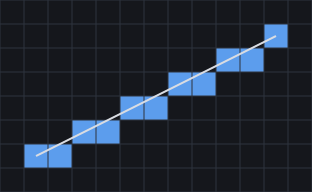
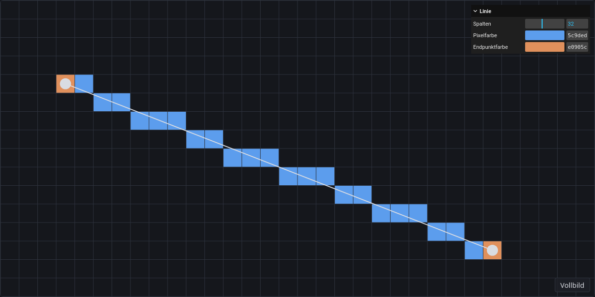

\begin{goals}
- Lorem ipsum dolor sit amet, consectetur adipiscing elit.
- Sed do eiusmod tempor incididunt ut labore et dolore magna aliqua.
- Ut enim ad minim veniam, quis nostrud exercitation.
\end{goals}

\begin{prerequisites}
Lorem ipsum aus Kapitel 3 der Vorlesung. Weiterführend: [Videos zum Bresenham-Algorithmus auf YouTube](https://www.youtube.com/results?search_query=bresenham+line+algorithm).
\end{prerequisites}

## Formeln

Lorem ipsum dolor sit amet: ein Punkt $\vect{p} = (x, y)^\top \in \R^2$ liegt auf der Geraden, wenn

$$
y = m x + b, \qquad m = \frac{\Delta y}{\Delta x}.
$$

\begin{note}
Duis aute irure dolor in reprehenderit in voluptate velit esse cillum dolore eu fugiat nulla pariatur.
\end{note}

## Abbildung



## Code

Excepteur sint occaecat cupidatat non proident, sunt in culpa qui officia deserunt mollit anim id est laborum.

```ts
function lerp(a: number, b: number, t: number): number {
    return a + (b - a) * t;
}
```

```glsl
float brightness = max(0.0, dot(normal, light));
```

## Ein Quadrat in WebGL

Ut enim ad minim veniam, quis nostrud exercitation ullamco laboris nisi ut aliquip ex ea commodo consequat. Stelle die Drehgeschwindigkeit über null, damit sich das Quadrat dreht. Den Shader kannst du links im Editor ändern und mit Run ausführen.

\demo{quad}[quad.vert, quad.frag]

\begin{webgl}
WebGL speichert Matrizen spaltenweise (column-major), die Vorlesung schreibt sie zeilenweise. Lorem ipsum dolor sit amet.
\end{webgl}

\begin{task}[Farbverlauf]
Sage voraus, wie das Quadrat aussieht, wenn du in `quad.frag` die Farbe mit `uv.x` multiplizierst. Probiere es danach im Editor aus.
\end{task}

## Eine Linie auf dem Raster

Duis aute irure dolor in reprehenderit in voluptate velit esse cillum dolore eu fugiat nulla pariatur. Ziehe die beiden Endpunkte mit der Maus.

\demo{line}

Gehe den Algorithmus Schritt für Schritt durch. Die Entscheidungsvariable $d$ bestimmt, ob $y$ im nächsten Schritt wächst.

\stepper{line}

\begin{task}[Endpunkte hervorheben]
Die Demo zeichnet die beiden Endpunkte in derselben Farbe wie alle anderen Pixel. Ändere den Code so, dass die Pixel der Endpunkte eine eigene Farbe bekommen, die man mit einem zweiten Farbwähler einstellt. Den Code findest du in \vscode{src/line/index.ts}[Steuerung] und \vscode{src/line/renderer.ts}[Zeichnen]. Nach dem Speichern lädt die Seite neu.

\begin{solution}

\end{solution}
\end{task}

\begin{summary}
Beschreibe in eigenen Worten, was du auf dieser Seite gelernt hast und wie du es umgesetzt hast. Save speichert deinen Text in \vscode{summary.md}[summary.md].

\textfield{summary.md}
\end{summary}

\begin{quiz}
\begin{question}
Welche Pixel setzt der Bresenham-Algorithmus für die Linie von $(0, 0)$ nach $(5, 2)$?
- [x] $(0, 0)$
- [ ] $(1, 1)$
- [x] $(2, 1)$
- [x] $(5, 2)$
\end{question}

\begin{question}
In welcher Datei wird die Farbe des Quadrats pro Pixel festgelegt?
- [ ] `quad.vert`
- [x] `quad.frag`
- [ ] `renderer.ts`
\end{question}
\end{quiz}
