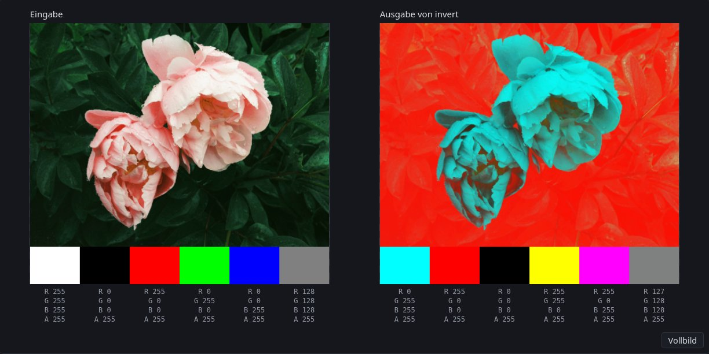
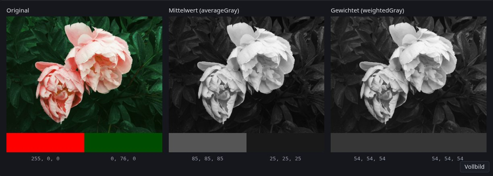
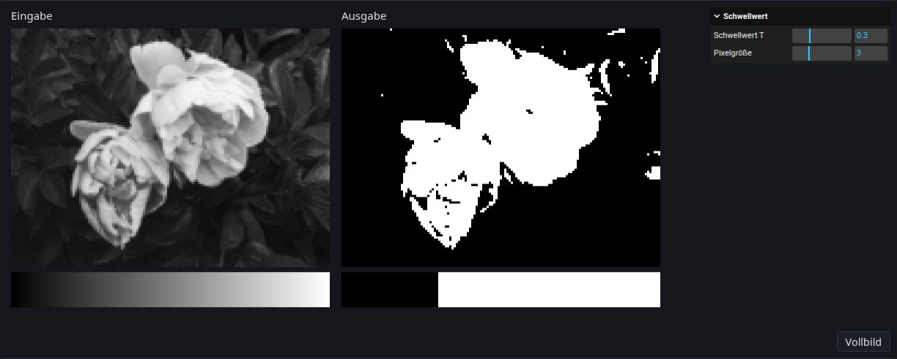
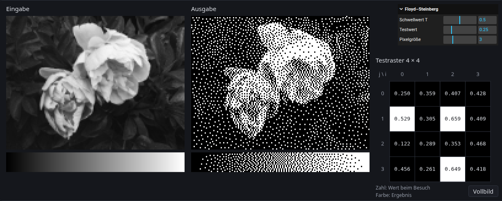
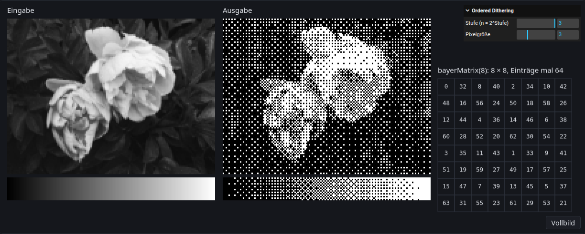

\begin{goals}
- Ein Farbbild mit dem Mittelwert und mit gewichteten Kanälen in Graustufen umwandeln und den Unterschied erklären.
- Schwellwert, Error Diffusion nach Floyd–Steinberg und Ordered Dithering mit einer Bayer-Matrix programmieren.
\end{goals}

\begin{prerequisites}
Kapitel 2 der Vorlesung, vor allem das RGB-Farbmodell, Raster mit Pixeln, Koordinaten und ihrer Implementierung, der PPM-Writer, die Graustufen-Umwandlung, die Farbquantisierung und das Dithering.

Weiterführend: [`ImageData`](https://developer.mozilla.org/de/docs/Web/API/ImageData), [`Uint8ClampedArray`](https://developer.mozilla.org/de/docs/Web/JavaScript/Reference/Global_Objects/Uint8ClampedArray) und [`Float32Array`](https://developer.mozilla.org/de/docs/Web/JavaScript/Reference/Global_Objects/Float32Array) bei MDN.
\end{prerequisites}

## Ein Bild ist ein Array

Im Browser liegt ein geladenes Bild als `ImageData` vor. Es hat eine Breite `width`, eine Höhe `height` und ein Array `data`. Das Array ist ein `Uint8ClampedArray` (Kapitel 2, Raster – Implementierung) und hat für jedes Pixel vier Bytes: Rot, Grün, Blau und Alpha, jedes zwischen 0 und 255.

Die Pixel liegen Zeile für Zeile hintereinander, oben links beginnend (wie beim PPM-Writer in Kapitel 2). Pixel $(i, j)$ ist das Pixel in Spalte $i$ und Zeile $j$, und $(0, 0)$ ist oben links. Bei einem Bild der Breite $W$ steht Kanal $c$ (0 für R, 1 für G, 2 für B, 3 für A) von Pixel $(i, j)$ am Index

$$
\text{index} = 4 \cdot (j \cdot W + i) + c.
$$

Umgekehrt gehört ein Index zum Pixel mit der Nummer $p = \lfloor \text{index} / 4 \rfloor$, also zu Spalte $i = p \bmod W$ und Zeile $j = \lfloor p / W \rfloor$, und zum Kanal $c = \text{index} \bmod 4$.

In Formeln rechnen wir mit Werten in $[0, 1]$ wie beim RGB-Farbmodell in Kapitel 2, im Array stehen Bytes von 0 bis 255. Zum Umrechnen teilt man durch 255.

Die Demo zeigt ein Testbild aus $6 \times 4$ Pixeln und darunter sein Array, eine Bildzeile pro Tabellenzeile. Unter der Maus erscheinen Pixel und Index.

\demo{pixel-index}

\begin{note}[Byte-Index]
Das Testbild ist $W = 6$ Pixel breit. Sage voraus und prüfe danach in der Demo:

1. An welchem Index steht das B-Byte von Pixel $(4, 2)$?
2. Zu welchem Pixel und Kanal gehört `data[57]`?
\end{note}

Ein Foto wird geladen, auf eine unsichtbare Canvas gezeichnet und mit `getImageData` ausgelesen:

```ts
const photo = new Image();
photo.src = flowerUrl;
await photo.decode();

const canvas = document.createElement("canvas");
canvas.width = photo.width;
canvas.height = photo.height;
const context = canvas.getContext("2d");
context.drawImage(photo, 0, 0);
const image = context.getImageData(0, 0, photo.width, photo.height);
```

Ein neues Bild legst du mit `new ImageData(width, height)` an. Alle Bytes sind dann 0, also schwarz und vollständig durchsichtig. Ein `Uint8ClampedArray` rundet beim Schreiben und schneidet ab: Aus 54.6 wird 55, aus 300 wird 255 und aus −20 wird 0. Ein gewöhnliches `Uint8Array` würde dagegen umbrechen, aus 300 würde 44.

Ein vollständiges Beispiel ist `invert` in \vscode{src/invert/invert.ts}[invert.ts]. Es geht alle Pixel in derselben Reihenfolge durch, in der sie im Array liegen, und schreibt das Ergebnis in ein neues Bild:

```ts
export function invert(image: ImageData): ImageData {
    const output = new ImageData(image.width, image.height);
    for (let j = 0; j < image.height; j++) {
        for (let i = 0; i < image.width; i++) {
            const index = 4 * (j * image.width + i);
            output.data[index] = 255 - image.data[index];
            output.data[index + 1] = 255 - image.data[index + 1];
            output.data[index + 2] = 255 - image.data[index + 2];
            output.data[index + 3] = image.data[index + 3];
        }
    }
    return output;
}
```

\demo{invert}

\begin{note}[Bytes schreiben]
Die Funktion steht in \vscode{src/invert/invert.ts}[invert.ts].

1. Ändere `invert` so, dass nur der Rot-Kanal invertiert wird und Grün und Blau unverändert bleiben. Schreibe vorher auf, welche Bytes die Felder Weiß, Schwarz, Rot und Grau 128 danach haben, und vergleiche mit der Demo.
2. Schreibe 0 statt des kopierten Alpha-Werts. Was erwartest du in der Ausgabe und in den Bytes, und warum? Stelle danach den ursprünglichen Code wieder her.

\begin{solution}

\end{solution}
\end{note}

## Graustufen

Ein Grauwert $I$ hat für Rot, Grün und Blau denselben Wert. Die Graustufen-Umwandlung in Kapitel 2 nennt zwei Gewichtungen:

$$
I = 0.299\,r + 0.587\,g + 0.114\,b \qquad \text{(YIQ)}
$$

$$
I = 0.2126\,r + 0.7152\,g + 0.0722\,b \qquad \text{(BT.709)}
$$

Die Gewichte beruhen auf der menschlichen Helligkeitswahrnehmung: Grün wirkt am hellsten, Rot mittel und Blau am dunkelsten. Der einfachste Ansatz ist der Mittelwert $I = (r + g + b) / 3$, der alle drei Kanäle gleich behandelt. Die Formeln gelten für Werte in $[0, 1]$ und genauso für Bytes, weil sie nur gewichtet addieren.

Sieh dir das rote und das blaue Feld unter dem Foto an. Wirken sie gleich hell?

\demo{grayscale}

\begin{task}[Graustufen]
Schreibe in \vscode{src/grayscale/gray.ts}[gray.ts] die Funktion `weightedGray` so, dass jedes Pixel den Grauwert $I = w_R\,r + w_G\,g + w_B\,b$ in R, G und B bekommt. Schreibe danach `averageGray` als einen einzigen Aufruf von `weightedGray`. Die Demo ruft `weightedGray` mit den BT.709-Gewichten auf; Gewichte und Farbfelder stehen in \vscode{src/grayscale/index.ts}[grayscale/index.ts].

1. Welche Bytes zeigen die beiden Graubilder für das rote Feld (#ff0000) und das blaue Feld (#0000ff)? Prüfe mit den Zahlen unter den Bildern.
2. Berechne, welcher reine Grünton #00??00 mit BT.709 denselben Grauwert hat wie Rot (±1), und was der Mittelwert für beide Farben liefert. Trage ihn in \vscode{src/grayscale/index.ts}[grayscale/index.ts] als zweite Farbe ein und prüfe.
3. Setze in \vscode{src/grayscale/index.ts}[grayscale/index.ts] alle drei Gewichte auf 1. Was passiert mit hellen Farben, und warum sollten die Gewichte zusammen 1 ergeben? Stelle danach die BT.709-Gewichte und die blaue Farbe wieder her.

\begin{solution}

\end{solution}
\end{task}

## Schwarz oder Weiß

Viele Ausgabegeräte kennen nur zwei Zustände pro Punkt, zum Beispiel Laserdrucker, Thermodrucker und E-Paper-Displays. Für sie muss ein Graubild auf Schwarz und Weiß reduziert werden (Halftoning, Kapitel 2, Dithering).

\begin{note}[Grauwerte als Float32Array]
Ab hier hat jedes Pixel nur einen Grauwert in $[0, 1]$, gespeichert in einem `Float32Array` mit dem Index $j \cdot W + i$. Floats sind nötig, weil beim Dithern negative Fehler und Werte über 1 entstehen, die ein `Uint8ClampedArray` abschneiden würde. `new Float32Array(width * height)` legt ein Array voller Nullen an. Die Funktionen geben ein neues Array zurück, in dem 0 schwarz und 1 weiß ist. Das Graubild entsteht mit `weightedGray` aus der Aufgabe Graustufen.
\end{note}

Der einfachste Weg zu Schwarz und Weiß ist ein Schwellwert $T$. Das ist eine Quantisierung auf ein Bit (Kapitel 2, Farbquantisierung):

$$
I'_{i,j} = \begin{cases} 1 & \text{wenn } I_{i,j} > T \\ 0 & \text{sonst.} \end{cases}
$$

\demo{threshold}

\begin{task}[Schwellwert]
Schreibe `applyThreshold` in \vscode{src/threshold/threshold.ts}[threshold.ts].

1. Welcher Anteil des Grauverlaufs wird bei $T = 0.3$ weiß? Prüfe in der Demo.
2. Ist bei $T = 0$ die Spalte ganz links weiß? Ist bei $T = 1$ die Spalte ganz rechts weiß? Prüfe in der Demo.

\begin{solution}

\end{solution}
\end{task}

Bei jedem Schwellwert gehen Details verloren: Alles unter $T$ wird gleich schwarz, alles darüber gleich weiß. Dithering hält die mittlere Helligkeit, indem es den Fehler, den die Quantisierung an einem Pixel macht, an seine Nachbarn weitergibt.

## Error Diffusion nach Floyd–Steinberg

Kapitel 2 beschreibt unter Dithering die Error Diffusion. Das Bild wird Zeile für Zeile von oben nach unten im „serpentine scanning“ durchlaufen. Jedes Pixel hat beim Besuch einen Wert $\tilde I_{i,j}$, das ist sein ursprünglicher Grauwert plus der Fehler, den es schon von früher besuchten Nachbarn bekommen hat. Daraus entstehen das Ergebnis und der Fehler

$$
I'_{i,j} = \begin{cases} 1 & \text{wenn } \tilde I_{i,j} > T \\ 0 & \text{sonst,} \end{cases} \qquad e = \tilde I_{i,j} - I'_{i,j}.
$$

Die Vorlesung spricht von der „Differenz zwischen der Originalfarbe und der neuen Farbe“. Mit der Originalfarbe ist der Wert beim Besuch gemeint, also $\tilde I_{i,j}$ und nicht der Grauwert aus der Eingabe. Der Fehler $e$ wird auf die Nachbarn verteilt, die noch nicht besucht wurden, mit den Gewichten von Floyd und Steinberg (Kapitel 2, Dithering – Fehlerverteilungen). $P$ ist das aktuelle Pixel:

$$
\begin{array}{ccc} - & P & \frac{7}{16} \\[4pt] \frac{3}{16} & \frac{5}{16} & \frac{1}{16} \end{array}
$$

Die Gewichte ergeben zusammen 1, es geht also kein Fehler verloren, außer am Bildrand: Fehler für Nachbarn außerhalb des Bildes fällt weg.

\begin{note}
Liest du außerhalb eines Typed Arrays, bekommst du `undefined`, und jede Rechnung damit wird `NaN`. Schreiben außerhalb wird stillschweigend ignoriert. Denk auch an die Frage zur ersten Demo: Was passiert mit einem Index, wenn $i$ über das Ende einer Zeile hinausgeht?
\end{note}

Die Funktion bekommt eine Kopie der Grauwerte als `gray`. Der Fehler wird in `gray` addiert, die Ergebnisse kommen in ein neues Array. So zeigt das Testraster der Demo den Wert $\tilde I$ jedes Pixels beim Besuch.

\demo{floyd-steinberg}

\begin{task}[Error Diffusion nach Floyd–Steinberg]
Schreibe `floydSteinberg` in \vscode{src/floyd-steinberg/floyd-steinberg.ts}[floyd-steinberg.ts]. Die Demo ruft die Funktion in \vscode{src/floyd-steinberg/index.ts}[floyd-steinberg/index.ts] auf. Schreibe dazu eine Hilfsfunktion, die einem Pixel $(i, j)$ einen Fehleranteil nur dann gibt, wenn es im Bild liegt, also wenn $0 \le i < W$ und $j < H$ gilt.

1. Rechne die erste Zeile des Testrasters von Hand aus (alle Werte 0.25, $T = 0.5$): Welchen Wert hat jedes Pixel beim Besuch? Schreibe den Code zuerst so, dass alle Zeilen von links nach rechts laufen, und prüfe die erste Zeile; sie ist bei beiden Reihenfolgen gleich. Ergänze dann serpentine scanning. Welches Pixel der zweiten Zeile wird jetzt zuerst besucht, und mit welchem Wert? Prüfe wieder.
2. Wie viele Pixel müssten weiß werden, damit das Testraster im Mittel so hell bleibt wie die Eingabe? Zähle in der Demo nach und erkläre die Abweichung.
3. Entferne in deiner Hilfsfunktion die Prüfung $i < W$. Was erwartest du? Was zeigt das Testraster, und warum gibt es keine Fehlermeldung? Stelle die Prüfung danach wieder her.

\begin{solution}

\end{solution}
\end{task}

\begin{task}[Jarvis oder Stucki (optional)]
Kapitel 2 zeigt unter Dithering – Fehlerverteilungen zwei größere Fehlerverteilungen, Jarvis et al. mit Gewichten in Achtundvierzigsteln und Stucki mit Gewichten in Zweiundvierzigsteln. Beide verteilen den Fehler auf zwölf Nachbarn: zwei in der aktuellen Zeile und je fünf in den beiden Zeilen darunter. Schreibe eine davon als neue Funktion `jarvis` oder `stucki` neben `floydSteinberg` in \vscode{src/floyd-steinberg/floyd-steinberg.ts}[floyd-steinberg.ts], mit deiner Hilfsfunktion und serpentine scanning. Rufe sie in \vscode{src/floyd-steinberg/index.ts}[floyd-steinberg/index.ts] statt `floydSteinberg` auf und stelle den Aufruf danach wieder zurück.

1. Welche Werte haben die ersten beiden Pixel des Testrasters? Prüfe.
2. Werden mehr oder weniger Pixel weiß als mit Floyd–Steinberg? Prüfe und erkläre.
3. Vergleiche die Muster im Grauverlauf: Wo bildet Floyd–Steinberg Linien oder Würmer, die mit der größeren Tabelle verschwinden?
\end{task}

## Ordered Dithering

\begin{note}[Über die Vorlesung hinaus: Ordered Dithering]
Die Vorlesung behandelt die Error Diffusion. Ordered Dithering mit einer Threshold-Map und die Bayer-Matrix sind eine Erweiterung in dieser Übung und werden hier erklärt.
\end{note}

Statt den Fehler weiterzugeben, kann jedes Pixel seinen eigenen Schwellwert bekommen. Die Schwellwerte stehen in einer kleinen $n \times n$-Threshold-Map $M$, die über das ganze Bild wiederholt wird:

$$
I'_{i,j} = \begin{cases} 1 & \text{wenn } I_{i,j} > M[j \bmod n][i \bmod n] \\ 0 & \text{sonst.} \end{cases}
$$

In TypeScript ist die Map ein `number[][]`, ein Array von Zeilen. Der erste Index ist die Zeile, deshalb steht $j$ vorne: `map[j % n][i % n]`. Der Schwellwert aus dem Abschnitt „Schwarz oder Weiß“ ist der Sonderfall einer Map mit nur einem Eintrag $T$.

\demo{ordered-dithering}

\begin{task}[Ordered Dithering]
Schreibe `orderedDithering` in \vscode{src/ordered-dithering/ordered-dithering.ts}[ordered-dithering.ts]. Die Map bekommt die Funktion als Parameter `map`.

1. Übergib in \vscode{src/ordered-dithering/index.ts}[ordered-dithering/index.ts] vorübergehend die Map `[[0.25, 0.75], [0.75, 0.25]]` statt des Ergebnisses von `bayerMatrix`. Wie sieht der Grauverlauf aus? Prüfe und stelle den Aufruf danach wieder her.
2. Welche Werte liest deine Schleife für Pixel $(i, j)$, und welche braucht `floydSteinberg`? Welches der beiden Verfahren könnte jedes Pixel unabhängig von den anderen berechnen? Vergleiche mit der Uniform Color Quantization in Kapitel 2: „Es wird keine Nachbarschaft betrachtet, daher parallel ausführbar.“
\end{task}

Eine gute Threshold-Map verteilt die Schwellwerte so, dass bei jeder Helligkeit die weißen Pixel gleichmäßig über die Fläche verstreut sind. Dafür benutzt man zum Beispiel eine Bayer-Matrix. In ganzen Zahlen ist $B_1 = [0]$ und

$$
B_{2n} = \begin{bmatrix} 4 B_n & 4 B_n + 2 \\ 4 B_n + 3 & 4 B_n + 1 \end{bmatrix}, \qquad \text{also} \quad B_2 = \begin{bmatrix} 0 & 2 \\ 3 & 1 \end{bmatrix}.
$$

Jeder Block der rechten Seite ist eine ganze $n \times n$-Matrix: Zu jedem Eintrag von $4 B_n$ wird dieselbe Zahl addiert. Die Map ist $M_n = B_n / n^2$, ihre Werte liegen also in $[0, 1)$.

\begin{task}[Bayer-Matrix]
Schreibe `bayerMatrix(n)` in \vscode{src/ordered-dithering/ordered-dithering.ts}[ordered-dithering.ts] für Zweierpotenzen $n$, rekursiv oder mit einer Schleife über die Stufen.

1. Rechne die erste Zeile von $B_4$ und die erste Zeile von $B_8$ von Hand aus. Prüfe mit der Anzeige bei Stufe 2 und 3.
2. Bei Stufe 1 ($n = 2$): Welcher Teil des Grauverlaufs wird rein weiß? Gibt es einen rein schwarzen Teil? Wirkt das Foto heller oder dunkler als die Eingabe? Prüfe und erkläre mit dem Mittelwert der Einträge von $M_2$.
3. Liefere stattdessen $(B_n + 0.5) / n^2$. Was ändert sich am Grauverlauf? Stelle danach $B_n / n^2$ wieder her.

\begin{solution}

\end{solution}
\end{task}

\begin{task}[Rauschen als Threshold-Map (optional)]
Schreibe in \vscode{src/ordered-dithering/ordered-dithering.ts}[ordered-dithering.ts] eine Funktion `noiseMap(n)`, die eine $n \times n$-Map mit Zufallswerten aus `Math.random()` liefert. Rufe sie in \vscode{src/ordered-dithering/index.ts}[ordered-dithering/index.ts] statt `bayerMatrix` auf, mit demselben $n$.

1. Wie sieht das Bild bei Pixelgröße 3 aus? Was passiert, wenn du einen Regler bewegst? Vergleiche mit Floyd–Steinberg und der Bayer-Matrix.
2. Warum siehst du im Foto ein Muster, das sich wiederholt, und was ändert sich mit `noiseMap(256)`?
\end{task}

\begin{summary}
Ein `ImageData` speichert ein Bild als Array von Bytes, vier pro Pixel und Zeile für Zeile; Kanal $c$ von Pixel $(i, j)$ steht am Index $4 \cdot (j \cdot W + i) + c$. Ein Grauwert ist eine gewichtete Summe der drei Farbkanäle, und die BT.709-Gewichte bilden die Helligkeitswahrnehmung besser ab als der Mittelwert. Ein einzelner Schwellwert reicht für ein Schwarz-Weiß-Bild nicht, weil Details verloren gehen. Dithering hält die mittlere Helligkeit auf zwei Arten: Error Diffusion nach Floyd–Steinberg verteilt den Fehler auf noch nicht besuchte Nachbarn und hängt deshalb von früheren Pixeln ab. Ordered Dithering vergleicht jedes Pixel mit einem eigenen Schwellwert aus einer Threshold-Map wie der Bayer-Matrix und kommt ohne andere Pixel aus.
\end{summary}

\begin{quiz}
Bei jeder Frage ist mindestens eine Antwort richtig, aber auch mehrere Antworten können richtig sein.

\begin{question}
Ein Bild ist $W = 5$ Pixel breit. An welchem Index steht der G-Wert von Pixel $(2, 1)$?
- [x] 29
- [ ] 28
- [ ] 9
- [ ] 13
\end{question}

\begin{question}
Was steht nach dem Schreiben in einem `Uint8ClampedArray`?
- [x] Aus 300 wird 255.
- [ ] Aus 300 wird 44.
- [x] Aus −20 wird 0.
- [ ] Aus 54.6 wird 54.
\end{question}

\begin{question}
Welche Aussagen über Rot $(1, 0, 0)$ und Dunkelgrün $(0, 0.5, 0)$ stimmen?
- [x] Mit dem Mittelwert ist Rot heller.
- [x] Mit BT.709 ist Dunkelgrün heller.
- [ ] Beide Verfahren ordnen die zwei Farben gleich.
\end{question}

\begin{question}
Floyd–Steinberg mit $T = 0.5$ in einer Zeile, die von links nach rechts läuft: Ein Pixel hat beim Besuch den Wert $0.6$. Was bekommt sein rechter Nachbar dazu?
- [x] $-0.175$
- [ ] $+0.175$
- [ ] $-0.4$
- [ ] $+0.2625$
\end{question}

\begin{question}
Bei Floyd–Steinberg würde ein Teil des Fehlers auf ein Pixel außerhalb des Bildes fallen. Was passiert mit diesem Anteil?
- [x] Er fällt weg.
- [ ] Er geht an das erste Pixel der nächsten Zeile.
- [ ] Er wird auf die übrigen Nachbarn verteilt.
- [ ] Er wird zum aktuellen Pixel addiert.
\end{question}

\begin{question}
Ordered Dithering mit der Bayer-Matrix $M_2 = \frac{1}{4} \begin{bmatrix} 0 & 2 \\ 3 & 1 \end{bmatrix}$. Eine Fläche hat überall den Grauwert $I = 0.1$, und ein Pixel wird weiß, wenn $I > M$ gilt. Welcher Anteil der Fläche wird weiß?
- [ ] 0 %
- [ ] 10 %
- [x] 25 %
- [ ] 50 %
\end{question}

\begin{question}
Du vertauschst in `orderedDithering` die Indizes zu `map[i % n][j % n]`. Was ändert sich mit der Bayer-Matrix $M_2$?
- [ ] Nichts, weil $M_2$ symmetrisch ist.
- [x] Das Muster wird an der Diagonale gespiegelt.
- [ ] Die mittlere Helligkeit ändert sich.
\end{question}

\begin{question}
Bei welchen Verfahren braucht ein Pixel die Ergebnisse anderer Pixel?
- [ ] Gewichtete Graustufen
- [ ] Schwellwert
- [x] Floyd–Steinberg
- [ ] Ordered Dithering
\end{question}
\end{quiz}
