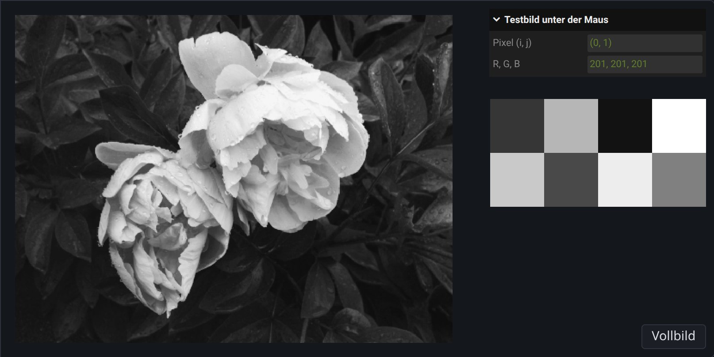
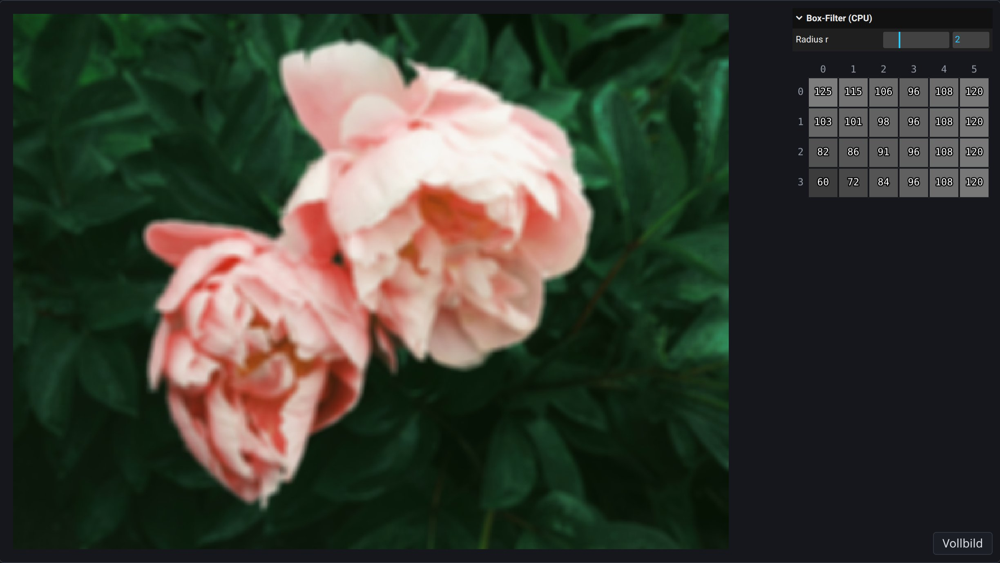
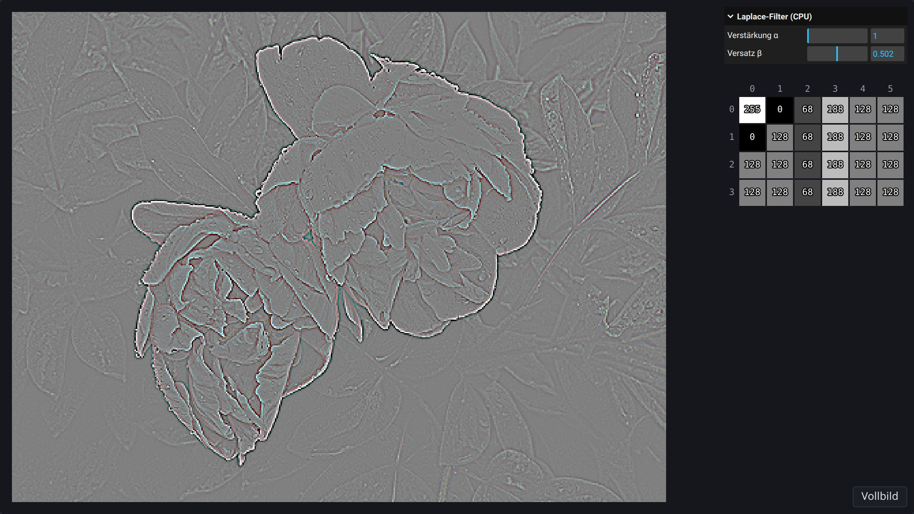

\begin{goals}
- Einen Fragment-Shader schreiben, der ein Bild Pixel für Pixel verändert.
- Zwischen Pixel $(i, j)$ und Texturkoordinate umrechnen.
- Box-Filter und Laplace-Filter als Schleife auf der CPU und als Fragment-Shader programmieren, mit derselben Randbehandlung.
- Erklären, was im Shader an die Stelle der Schleifen, des Index und des Schreibens ins Array tritt.
- Erklären, warum die GPU ein Bild schneller filtert als eine Schleife auf der CPU.
\end{goals}

\begin{prerequisites}
Kapitel 2 der Vorlesung, vor allem Folie 27 (normierte Koordinaten), Folie 28 (Raster auf CPU und GPU), Folie 44 (Graustufen), Folie 46 (Bildoperationen pro Pixel auf der GPU), Folie 55–60 (Bildfaltung), Folie 71 (Randbehandlung) und Folie 72 (Bild als Textur). Aus Kapitel 1 Folie 35 („Hello, World!“ für WebGL). Die Übung „Graustufen und Dithering“ für `ImageData` und Schleifen über Pixel.

Weiterführend: die [Kurzreferenz zu OpenGL ES 3.0](https://www.khronos.org/files/opengles3-quick-reference-card.pdf) mit GLSL ES 3.00 auf den letzten Seiten und ein [Video zum Box-Filter](https://www.youtube.com/watch?v=YJVYX8tllj4).
\end{prerequisites}

## Von der Schleife zum Fragment-Shader

Auf der CPU geht eine Schleife alle Pixel nacheinander durch:

```ts
const output = new ImageData(image.width, image.height);
for (let j = 0; j < image.height; j++) {
    for (let i = 0; i < image.width; i++) {
        const index = 4 * (j * image.width + i);
        // read image.data[index], …, image.data[index + 3]
        // and write output.data[index], …, output.data[index + 3]
    }
}
```

Eine Bildoperation, die jedes Pixel unabhängig von den anderen berechnet, kann die GPU parallel ausführen (Kapitel 2, Folie 46). Dafür liegt das Bild als Textur auf der GPU (Folie 28 und 72). Ein Viereck aus zwei Dreiecken bedeckt die Fläche, auf der das Bild erscheinen soll, und beim Rasterisieren entsteht für jedes Pixel der Canvas in dieser Fläche ein Fragment (Kapitel 1, Folie 35). Für jedes Fragment läuft einmal die Funktion `main` des Fragment-Shaders. Sie entspricht dem Rumpf der Schleife; die Schleife selbst gibt es nicht mehr:

```glsl
#version 300 es

precision highp float;

uniform sampler2D image;
uniform vec2 size;

in vec2 uv;

out vec4 fragColor;

void main() {
    // read texture(image, uv) and write fragColor
}
```

Die erste Zeile wählt die Sprachversion GLSL ES 3.00 und muss ganz oben stehen. `precision highp float` rechnet mit 32-Bit-Floats.

Die Variablen vor `main` verbinden den Shader mit seiner Umgebung, und ihr Schlüsselwort sagt, woher ein Wert kommt. Ein `uniform` setzt der TypeScript-Code vor dem Zeichnen, und er hat in allen Fragmenten denselben Wert, ein globaler Parameter wie der Drehwinkel in Kapitel 1, Folie 35. Hier sind das das Eingabebild `image` als Textur und seine Größe `size` $= (W, H)$ in Pixeln. Ein `in` hat in jedem Fragment einen eigenen Wert, den der Vertex-Shader liefert; hier ist das die Texturkoordinate `uv` aus `quad.vert`. Ein `out` ist das Ergebnis des Fragments, hier seine Farbe `fragColor`.

`texture(image, uv)` liest die Farbe an der Stelle `uv` als `vec4` mit Werten in $[0, 1]$. Die Textur ist auf Nearest Filtering eingestellt (Folie 72), `texture` liefert also ohne Interpolation das Pixel des Bildes, in dessen Fläche `uv` liegt. Die Demos zeigen das Bild vergrößert, deshalb bedeckt ein Pixel des Bildes viele Fragmente, und alle lesen dasselbe Pixel. Was der Shader in `fragColor` schreibt, wird als Byte gespeichert: Jeder Wert wird auf $[0, 1]$ begrenzt und als $\operatorname{round}(255 \cdot x)$ abgelegt.

Vektoren heißen `vec2`, `vec3` und `vec4`. Ihre Komponenten liest man mit `.r`, `.g`, `.b`, `.a` oder `.x`, `.y`, `.z`, `.w`, auch mehrere auf einmal: `color.rgb` ist ein `vec3`. `vec3(x)` setzt alle drei Komponenten auf `x`, und `vec4(color.rgb, 1.0)` baut aus einem `vec3` und einer Zahl einen `vec4`. `+`, `-` und `*` mit einer Zahl rechnen komponentenweise, und `dot(a, b)` ist das Skalarprodukt. Kommazahlen werden mit Punkt geschrieben, etwa `0.5`. GLSL wandelt zwischen `int` und `float` nie von selbst um. Eigene Funktionen stehen vor `main` und haben den Rückgabetyp vorne, etwa `vec3 pixel(vec2 offset) { … }`.

Ein Shader kann nichts in die Konsole schreiben. Fehler beim Übersetzen erscheinen unter dem Editor; alles andere zeigt sich nur im Bild. Einen Zwischenwert prüft man, indem man ihn in `fragColor` schreibt, zum Beispiel mit `fragColor = vec4(uv, 0.0, 1.0);`. Werte unter 0 werden dabei schwarz.

\begin{webgl}
Die Vorlesung bildet Pixel $(i, j)$ auf $(u, v) = \left(\frac{i}{W-1}, \frac{j}{H-1}\right)$ ab (Kapitel 2, Folie 27). Bei einer Textur ist $u = 0$ der linke Rand des ersten Pixels und $u = 1$ der rechte Rand des letzten. Die Mitte von Pixel $(i, j)$ liegt deshalb bei $(u, v) = \left(\frac{i + 0.5}{W}, \frac{j + 0.5}{H}\right)$, wie beim Subsampling auf derselben Folie.

Auf der Canvas zählt WebGL die Zeilen von unten. `quad.vert` gibt `uv` deshalb so vor, dass $v = 0$ oben liegt und $v$ wie $j$ nach unten wächst. Das Bild wird mit seiner obersten Zeile zuerst hochgeladen, so dass es aufrecht erscheint.
\end{webgl}

\demo{gray-shader}[gray.frag]

\begin{task}[Dein erster Fragment-Shader]
Der Shader steht links im Editor und in \vscode{src/gray-shader/gray.frag}[gray.frag]. Schreibe den Shader so, dass jedes Pixel seinen BT.709-Grauwert bekommt (Kapitel 2, Folie 44).

1. Vorhersage: Ersetze die letzte Zeile von `main` vorübergehend durch `fragColor = vec4(uv, 0.0, 1.0);`. Welche Farbe erwartest du in den vier Ecken des Fotos? Prüfe und stelle die Zeile danach wieder her.
2. Vorhersage: Welche Grauwerte in Bytes bekommen Cyan, Magenta und Gelb in der unteren Zeile des Testbilds? Prüfe, indem du die Maus über das Testbild bewegst.
3. Ausprobieren: Füge die Zeile `float one = 1;` in `main` ein und klicke Run. Was meldet der Editor, und in welcher Zeile? Stelle danach den Shader wieder her.

\begin{solution}

\end{solution}
\end{task}

## Bildfaltung

Bei einer Bildfaltung hängt jedes Ausgabepixel von einer Nachbarschaft des Eingabepixels ab (Folie 55). Ein Filterkern $K$ gibt an, mit welchem Gewicht jeder Nachbar eingeht. Für einen Kern mit Radius $r$, also der Größe $(2r+1) \times (2r+1)$, ist

$$
I'_{i,j} = \sum_{l=-r}^{r} \sum_{k=-r}^{r} K_{k,l} \cdot I_{i+k,\,j+l}.
$$

$k$ ist die Verschiebung in der Spalte und $l$ die Verschiebung in der Zeile; $K_{k,l}$ steht im Kern in Spalte $k$ und Zeile $l$, vom Mittelpunkt aus gezählt. Bei einem Farbbild wird jeder der Kanäle R, G und B für sich gefaltet, Alpha bleibt.

Der Box-Filter mittelt gleichmäßig (Folie 56): Alle $(2r+1)^2$ Gewichte sind $\frac{1}{(2r+1)^2}$. Für $r = 1$ ist das der $3 \times 3$-Kern von der Folie.

Am Rand fehlen Nachbarn. Folie 55 nennt zwei Lösungen; hier werden die Randpixel repliziert: Ein Nachbar außerhalb des Bildes wird durch das nächste Pixel im Bild ersetzt, also durch das Pixel, dessen Spalte auf $[0, W-1]$ und dessen Zeile auf $[0, H-1]$ begrenzt ist.

Das Testbild der folgenden Demos hat $6 \times 4$ Pixel mit diesen Grauwerten in Bytes, die Zeile $j = 0$ oben:

$$
\begin{bmatrix} 240 & 60 & 60 & 120 & 120 & 120 \\ 60 & 60 & 60 & 120 & 120 & 120 \\ 60 & 60 & 60 & 120 & 120 & 120 \\ 60 & 60 & 60 & 120 & 120 & 120 \end{bmatrix}
$$

\demo{box-blur-cpu}

\begin{task}[Box-Filter auf der CPU]
Schreibe `boxBlur` in \vscode{src/box-blur-cpu/box-blur.ts}[box-blur.ts]: Jedes Pixel bekommt den Mittelwert über alle $(2r+1)^2$ Pixel seiner Nachbarschaft, mit replizierten Randpixeln. Schreibe das Ergebnis in ein neues Bild. Die Demo ruft die Funktion in \vscode{src/box-blur-cpu/index.ts}[box-blur-cpu/index.ts] mit einer Kopie der Eingabe auf.

1. Vorhersage: Welchen Wert hat Pixel $(3, 2)$ bei $r = 1$, Pixel $(0, 0)$ bei $r = 1$ und Pixel $(0, 2)$ bei $r = 2$? Prüfe im Testbild.
2. Ausprobieren: Schreibe die Ergebnisse nicht in ein neues Bild, sondern direkt in `image`, und gib `image` zurück. Welchen Wert erwartest du dann für Pixel $(1, 0)$ bei $r = 1$? Prüfe. Floyd–Steinberg gibt seinen Fehler absichtlich an noch nicht besuchte Pixel weiter. Warum ist dasselbe hier ein Fehler? Stelle danach deinen Code wieder her.

\begin{solution}

\end{solution}
\end{task}

## Box-Filter auf der GPU

Ein Fragment-Shader bestimmt nur die Farbe seines eigenen Fragments, kann aber jede Stelle der Eingabe lesen. Eine Schleife über die Pixel gibt es im Shader nicht, die Nachbarn liest er aber selbst aus der Textur. Die Textur ist so eingestellt, dass sie außerhalb von $[0, 1]$ das Randpixel wiederholt (CLAMP_TO_EDGE, der Modus „clamp“ auf Folie 71). Das ist dieselbe Replikation wie auf der CPU, ohne eigenen Code.

\begin{note}[Schleifen im Shader]
GLSL kennt `for`-Schleifen wie TypeScript, mit dem Typ `int` für ganze Zahlen: `for (int n = 0; n < 4; n++) { … }`. Ein `int` wird mit `float(n)` zu einem `float`, und `vec2` nimmt auch zwei `int`. Anders als in TypeScript rechnet `1 / 9` mit zwei `int` ganzzahlig und ergibt 0.
\end{note}

\demo{box-blur-gpu}[box-blur.frag]

\begin{task}[Box-Filter auf der GPU]
Schreibe den Box-Filter in \vscode{src/box-blur-gpu/box-blur.frag}[box-blur.frag], mit dem Uniform `radius` für $r$.

1. Vorhersage: Um wie viel ändert sich $u$ von einem Pixel des Bildes zu seinem rechten Nachbarn? Welche Texturkoordinate hat damit der Nachbar mit der Verschiebung $(k, l)$? Schreibe sie mit `uv` und `size`.
2. Prüfe: Sehen Foto und Testbild für mehrere Radien so aus wie in der Demo zur CPU?
3. Erklären: Welche Zeilen deines `boxBlur` braucht der Shader nicht, und was tritt an ihre Stelle? Warum kann der Fehler, den du in der vorigen Aufgabe ausprobiert hast, im Shader nicht auftreten?
\end{task}

## CPU und GPU im Vergleich

Die CPU berechnet ein Pixel nach dem anderen. Die GPU hat viele Recheneinheiten und berechnet die Fragmente gleichzeitig. Der Step-through zeigt das vereinfacht für den Box-Filter mit $r = 1$ auf dem Testbild. Jedes Pixel braucht zwei Schritte: Im ersten liest es seine Nachbarschaft, im zweiten wird sein Ergebnis geschrieben. Links macht die CPU das für ein Pixel nach dem anderen, rechts macht die GPU es für alle Pixel zugleich. Das geht, weil jedes Pixel nur die Eingabe liest und kein Ergebnis eines anderen Pixels braucht.

\stepper{cpu-gpu}

\begin{task}[CPU und GPU im Vergleich]
Diese Aufgabe braucht deinen Code aus den beiden Aufgaben zum Box-Filter.

1. Ausprobieren: Ziehe in beiden Demos zum Box-Filter den Regler „Radius r“ langsam von 0 bis 8. Welche Demo folgt dem Regler nicht mehr flüssig, und ab welchem Radius etwa?
2. Erklären: Im Step-through braucht die CPU 48 Schritte und die GPU zwei. Wie viele Schritte bräuchte die CPU für das Foto mit $480 \times 360$ Pixeln? Liest die GPU weniger Pixel als die CPU? Warum ist sie trotzdem schneller?
\end{task}

## Kanten mit dem Laplace-Filter

Der Laplace-Filter (Folie 60) nähert die zweite Ableitung des Bildes an. Hier wird die Maske mit vier Nachbarn benutzt:

$$
K = \begin{bmatrix} 0 & -1 & 0 \\ -1 & 4 & -1 \\ 0 & -1 & 0 \end{bmatrix}
$$

$$
L_{i,j} = 4 I_{i,j} - I_{i-1,j} - I_{i+1,j} - I_{i,j-1} - I_{i,j+1}
$$

In einer gleichmäßigen Fläche ist $L = 0$. An einer Kante ist $L$ auf der einen Seite positiv und auf der anderen negativ, und das Zero-Crossing dazwischen markiert die Lage der Kante. Damit auch negative Werte sichtbar werden, zeigen die Demos für jeden Kanal

$$
I' = \beta + \alpha \cdot L,
$$

ähnlich wie bei der Kontrastanpassung auf Folie 46. Dabei sind $I$, $L$, $\beta$ und $I'$ Werte in $[0, 1]$ wie im Shader, und die Verstärkung $\alpha$ ist ein Faktor. Rechnet man $L$ in Bytes, ist das Ergebnis in Bytes $255 \beta + \alpha L$, mit $\alpha = 1$ und $\beta = 128/255$ also $128 + L$. Der Rand wird wie beim Box-Filter repliziert.

\demo{laplace-cpu}

\begin{task}[Laplace auf der CPU]
Schreibe `laplace` in \vscode{src/laplace-cpu/laplace.ts}[laplace.ts].

1. Vorhersage: Welche Bytes bekommen die Pixel $(2, 2)$, $(3, 2)$, $(1, 1)$ und $(0, 0)$ des Testbilds bei $\alpha = 1$ und $\beta = 128/255$? Prüfe.
2. Ausprobieren: Setze $\beta = 0$. Was passiert mit den Kanten im Testbild und im Foto, und warum ist das Zero-Crossing nicht mehr zu sehen?

\begin{solution}

\end{solution}
\end{task}

\demo{laplace-gpu}[laplace.frag]

\begin{task}[Laplace auf der GPU]
Schreibe den Laplace-Filter in \vscode{src/laplace-gpu/laplace.frag}[laplace.frag], mit den Uniforms `alpha` und `beta`.

1. Prüfe: Sehen Foto und Testbild für mehrere Werte von $\alpha$ und $\beta$ so aus wie in der Demo zur CPU?
2. Ausprobieren: Ersetze in \vscode{src/laplace-gpu/renderer.ts}[laplace-gpu/renderer.ts] beide `CLAMP_TO_EDGE` durch `REPEAT`. Dann gilt auf der GPU die Torus-Topologie von Folie 55. Was erwartest du für die rechte Spalte des Testbilds und für den Rand des Fotos? Prüfe und stelle danach `CLAMP_TO_EDGE` wieder her.
\end{task}

\begin{task}[Rauschen (optional)]
Folie 60 nennt den Laplace-Filter rauschempfindlich und empfiehlt, vorher zu glätten. Der Regler „Rauschen a“ der Demo zur GPU addiert zu R, G und B jedes Pixels im Foto einen Zufallswert zwischen $-a$ und $a$. Glätte das Bild in \vscode{src/laplace-gpu/laplace.frag}[laplace.frag] vor dem Laplace-Filter mit dem $3 \times 3$-Gauss-Filter von Folie 56. Schreibe dazu eine Funktion, die den geglätteten Wert an einer Stelle liefert, und wende den Laplace-Filter auf diese Werte an.

1. Vorhersage: Rauschen $a = 0.05$ verschiebt jeden Kanal um bis zu $0.05 \cdot 255 \approx 13$ Bytes. Wie groß kann $|L|$ ohne Glättung in einer gleichmäßigen Fläche höchstens werden? Ist das mehr oder weniger als $|L|$ an der Kante zwischen 60 und 120 im Testbild? Sieh dir das Foto mit Rauschen 0.05 an.
2. Vorhersage: Wie verändern sich mit Glättung die Körnung und die Kanten im Foto und im Testbild? Prüfe. Stelle danach deinen Laplace-Filter ohne Glättung wieder her.
\end{task}

## Eigene Bildfaltungen

Folie 56–59 zeigen weitere Kerne: Gauss-Filter, Motion-Blur, Embossing und Sharpening.

\demo{convolution}[convolution.frag]

\begin{task}[Eigene Bildfaltung (optional)]
Schreibe in \vscode{src/convolution/convolution.frag}[convolution.frag] eine Bildfaltung mit einem Kern deiner Wahl, zum Beispiel einem von Folie 56–59 oder dem Schärfen $I' = I + \alpha \cdot L$ von Folie 60. Lies $K_{k,l}$ wie in der Formel oben: Spalte $k$ und Zeile $l$, vom Mittelpunkt aus.

1. Vorhersage: Die Gewichte des Embossing-Kerns ergeben zusammen 0. Was zeigt er in einer gleichmäßigen Fläche, und was brauchst du wie beim Laplace-Filter, damit man etwas sieht? Prüfe.
2. Vorhersage: Sage für jeden weiteren Kern vorher, was er mit dem Testbild macht, und prüfe danach.
\end{task}

\begin{summary}
Ein Fragment-Shader entspricht dem Rumpf einer Schleife über alle Pixel: Die GPU führt `main` einmal pro Fragment aus, `uv` ersetzt die Schleifenvariablen, `texture` das Lesen aus dem Array und `fragColor` das Schreiben. Jedes Fragment bestimmt nur seine eigene Farbe und liest dafür aus der Eingabetextur. Bei einer Bildfaltung hängt jedes Ausgabepixel von einer Nachbarschaft ab, gewichtet mit einem Filterkern. Der Box-Filter mittelt, der Laplace-Filter reagiert auf Helligkeitsänderungen mit positiven und negativen Werten. Am Rand begrenzt die CPU die Indizes, auf der GPU übernimmt das die Textur mit CLAMP_TO_EDGE. Weil die Pixel unabhängig sind, berechnet die GPU sie gleichzeitig, während die CPU sie nacheinander berechnet; beide lesen gleich viele Pixel.
\end{summary}

\begin{quiz}
Bei jeder Frage ist mindestens eine Antwort richtig, aber auch mehrere Antworten können richtig sein.

\begin{question}
Box-Filter mit $r = 1$: Ein Pixel hat den Wert 90, seine acht Nachbarn haben alle den Wert 0. Welchen Wert hat das Pixel danach?
- [x] 10
- [ ] 0
- [ ] 30
- [ ] 90
\end{question}

\begin{question}
Laplace-Filter $L = 4 I_{i,j} - I_{i-1,j} - I_{i+1,j} - I_{i,j-1} - I_{i,j+1}$, in Bytes gerechnet und als $128 + L$ angezeigt: Ein Pixel hat das Byte 100, seine vier Nachbarn haben 100, 100, 80 und 80. Welches Byte ergibt sich?
- [x] 168
- [ ] 88
- [ ] 128
- [ ] 40
\end{question}

\begin{question}
Welche Aussagen über den Fragment-Shader des Box-Filters stimmen?
- [x] `main` läuft einmal für jedes Fragment.
- [x] In welcher Reihenfolge die Fragmente berechnet werden, ist nicht festgelegt.
- [x] Er liest die Nachbarn aus der Eingabetextur.
- [ ] Er kann in andere Fragmente schreiben.
- [ ] Er liest die Ergebnisse von Nachbarn, die schon fertig sind.
\end{question}

\begin{question}
Ein Bild hat $W = 480$ und $H = 360$ Pixel. Welche Texturkoordinate $(u, v)$ hat die Mitte von Pixel $(0, 359)$, wenn $v = 0$ der obere Rand des Bildes ist?
- [x] $\left(\frac{0.5}{480}, \frac{359.5}{360}\right)$
- [ ] $(0, 1)$
- [ ] $\left(0, \frac{359}{360}\right)$
- [ ] $(0.5, 359.5)$
\end{question}

\begin{question}
Ein Fragment-Shader schreibt `fragColor = vec4(vec3(0.5 + L), 1.0);`. Für ein Fragment ist $L = -0.7$. Welches Byte steht danach in R?
- [x] 0
- [ ] 51
- [ ] 128
- [ ] 255
\end{question}

\begin{question}
Eine Variante von `boxBlur` schreibt jedes Ergebnis sofort in das Eingabebild statt in ein neues Bild. Was stimmt?
- [x] Spätere Pixel lesen schon geglättete Werte.
- [x] Das Ergebnis hängt davon ab, in welcher Reihenfolge die Pixel besucht werden.
- [ ] Das Ergebnis ändert sich nicht, nur der Speicherbedarf sinkt.
\end{question}
\end{quiz}
