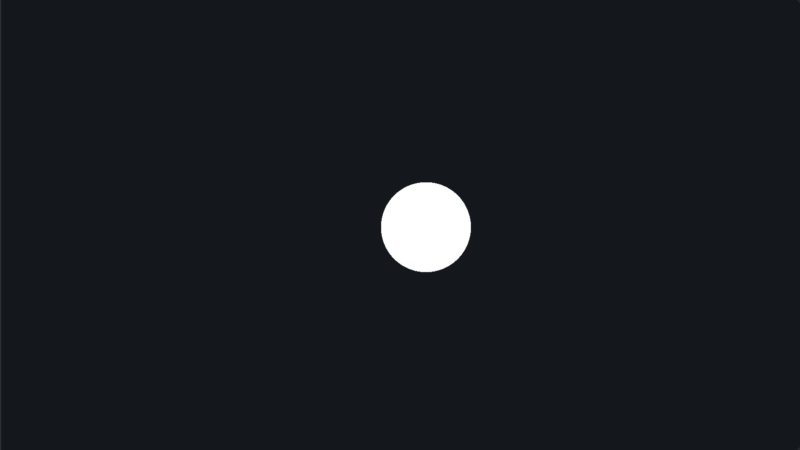
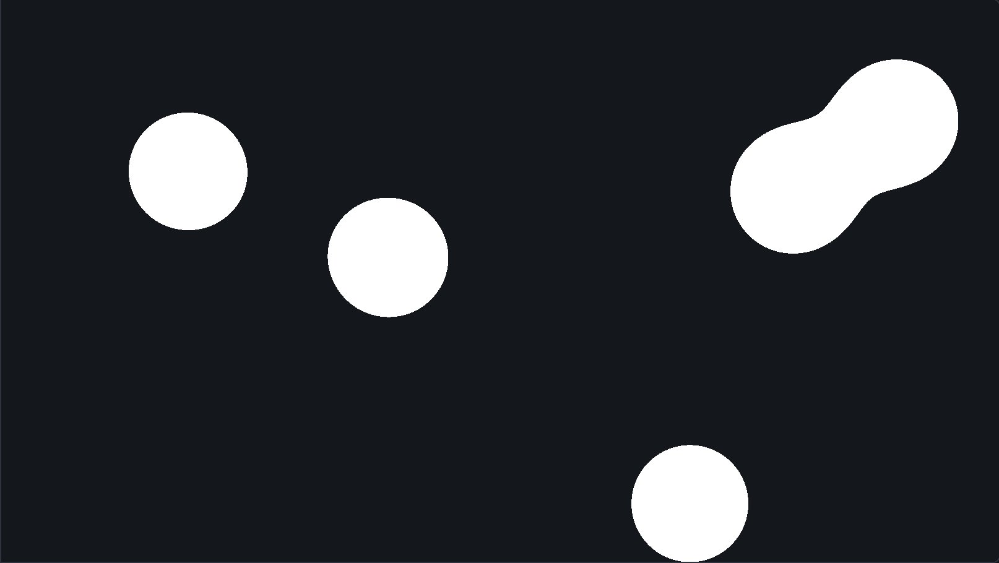
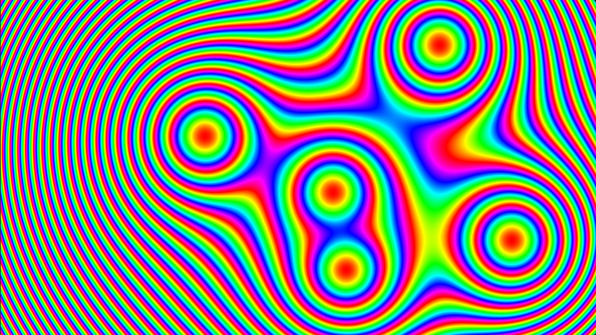

\begin{goals}
- In jedem Fragment eine Funktion der Position auswerten und den Wert als Farbe ausgeben.
- Pixelkoordinaten so umrechnen, dass Kreise auf jeder Canvas rund bleiben.
- Das Prinzip von Metabällen erklären und eine Kombination für mehrere Bälle finden.
- Einen Wert mit HSV auf eine Farbe abbilden.
\end{goals}

\begin{prerequisites}
Kapitel 2 der Vorlesung, vor allem Folie 10–11 (HSV), Folie 27 (normierte Koordinaten), Folie 39–41 (2D-Funktionsplots) und Folie 48 (uniforme Quantisierung). Die Übung „Bildfilter auf CPU und GPU“ für den Einstieg in Fragment-Shader.

Weiterführend: die [Kurzreferenz zu OpenGL ES 3.0](https://www.khronos.org/files/opengles3-quick-reference-card.pdf) mit GLSL ES 3.00 auf den letzten Seiten.
\end{prerequisites}

## Ein Bild als Funktion

Bisher hat ein Fragment-Shader ein vorhandenes Bild verändert. Er kann ein Bild aber auch ganz neu berechnen: Jedes Pixel bekommt eine Farbe, die nur von seiner Position abhängt. So stellt Kapitel 2, Folie 39 Funktionen mit zwei Variablen dar: Jedes Pixel steht für einen Punkt der Ebene, und der Funktionswert an diesem Punkt bestimmt seine Farbe.

Die Bälle auf dieser Seite haben Positionen und Radien in Einheiten der Höhe der Canvas: $y$ läuft von 0 am oberen bis 1 am unteren Rand, und $x$ hat dieselbe Einheit, so dass ein Kreis auf jeder Canvas rund bleibt. `uv` läuft dagegen in beide Richtungen von 0 bis 1. Das Uniform `size` enthält die Größe der Canvas in Pixeln.

\begin{webgl}
`uv` ist die Mitte eines Pixels, $\frac{i + 0.5}{W}$ statt $\frac{i}{W-1}$ wie auf Folie 39, und $v$ wächst wie $j$ nach unten, wie in der Übung „Bildfilter auf CPU und GPU“.
\end{webgl}

\begin{note}[Über die Vorlesung hinaus: Metabälle]
Metabälle sind Kreise, die wie Tropfen ineinanderfließen, wenn sie sich nahekommen. Jeder Ball hat einen Einfluss, der an seinem Mittelpunkt am größten ist und nach außen abnimmt. Für einen Ball mit dem Mittelpunkt $(x_0, y_0)$ und dem Radius $r$ ist das

$$
f(x, y) = \frac{(\lambda r)^2}{(x - x_0)^2 + (y - y_0)^2},
$$

mit einem Radiusfaktor $\lambda$, der alle Bälle zugleich größer oder kleiner macht. Ein Punkt gehört zum Ball, wenn der Einfluss dort größer als ein Schwellwert $T$ ist.
\end{note}

\demo{one-ball}[one-ball.frag]

\begin{task}[Ein Ball]
Der Shader steht links im Editor und in \vscode{src/one-ball/one-ball.frag}[one-ball.frag]. `ball.xy` ist der Mittelpunkt des Balls, `ball.z` sein Radius und `lambda` der Radiusfaktor. Berechne zuerst die Position des Fragments in denselben Einheiten wie der Ball, dann den Einfluss des Balls an dieser Position, und färbe das Fragment mit `insideColor`, wenn der Einfluss größer als $T$ ist, sonst mit `outsideColor`.

1. Vorhersage: Welchen Radius hat die gefüllte Kreisscheibe, abhängig von $\lambda$, $r$ und $T$? Wie groß ist sie bei $T = 4$ und bei $T = 0.25$ im Vergleich zu $T = 1$? Prüfe.
2. Ausprobieren: Nimm vorübergehend `uv` direkt als Position. Welche Form erwartest du für den Ball, und wo ist er, während sein Mittelpunkt bei $x > 1$ liegt? Prüfe und stelle danach deinen Code wieder her.

\begin{solution}

\end{solution}
\end{task}

\begin{note}
`dot(d, d)` ist das Quadrat der Länge eines Vektors `d`. Ist `d` die Differenz zweier Punkte, ist das ihr quadrierter Abstand.
\end{note}

## Viele Bälle

Erst mit mehreren Bällen entsteht der Effekt der Metabälle: Nähern sich zwei Bälle, beulen sie sich zueinander aus und fließen zusammen, bevor sich ihre Kreise berühren, und lösen sich wieder voneinander wie zwei Tropfen. Dafür werden an jedem Punkt die Einflüsse aller Bälle zu einem einzigen Wert $F$ kombiniert, der dann mit $T$ verglichen wird. Alle Bälle der Demos haben den Radius $r = 0.1$.

\demo{metaballs}[metaballs.frag]

\begin{task}[Metabälle]
Die Bälle stehen im Uniform `balls`: `balls[k].xy` ist der Mittelpunkt und `balls[k].z` der Radius von Ball $k$, und `count` gibt an, wie viele Bälle es gibt. Schreibe in \vscode{src/metaballs/metaballs.frag}[metaballs.frag] die Funktion `field`, die die Einflüsse aller Bälle an einer Position zu $F$ kombiniert, und benutze sie in `main` wie in der vorigen Aufgabe.

1. Ausprobieren: Kombiniere die Einflüsse einmal mit dem Maximum und einmal mit der Summe. Bei welcher Kombination fließen zwei Bälle zusammen, bevor sich ihre Kreise berühren?
2. Prüfe: Halte die Bälle mit Geschwindigkeit 0 an, wenn ihre Mittelpunkte etwa eineinhalb Durchmesser voneinander entfernt sind, und erhöhe $\lambda$ langsam, bis sie sich verbinden.
3. Vorhersage: Welcher Schwellwert $T$ ergibt bei $\lambda = 1.5$ dasselbe Bild wie $T = 1$ bei $\lambda = 1$? Prüfe mit Geschwindigkeit 0.

\begin{solution}

\end{solution}
\end{task}

## Psychedelisch

Statt nur innen und außen zu unterscheiden, kann man $F$ auch über die Farbe zeigen. Dafür eignet sich HSV (Kapitel 2, Folie 10): Der Buntton (Hue) ist ein Winkel auf dem Farbkreis, Sättigung und Helligkeit bleiben dabei fest. Folie 41 färbt die Julia-Menge, indem sie einen Wert auf den Buntton abbildet. Die Shader ab hier enthalten die Umrechnung von Folie 11 als Funktion `hsv2rgb(h, s, v)`, mit $h$ von 0 bis knapp 1 statt in Grad.

Vor deinem Code zeigt die Demo den Buntton $h$ von 0 am linken bis knapp 1 am rechten Rand.

\demo{psychedelic}[psychedelic.frag]

\begin{task}[Psychedelisch]

Schreibe \vscode{src/psychedelic/psychedelic.frag}[psychedelic.frag] so, dass deine Metabälle wie im Bild aussehen. Übernimm dazu deine Funktion `field` aus `metaballs.frag`.

1. Vorhersage: Welche Größe, die du aus $F$ berechnen kannst, ist an den Mittelpunkten der Bälle 0 und wächst nach außen? Wie wird daraus ein Buntton, der sich wiederholt?
2. Erklären: Warum gibt es zwischen zwei Ringen keine harte Kante, obwohl der Buntton dort von fast 1 auf 0 springt?
3. Ausprobieren: Stelle Anzahl 1 ein und verdopple $\lambda$. Wie ändern sich die Ringe, und was passiert mit den Mustern weit weg vom Ball? Denk an Folie 27: Ein Pixel ist ein Abtastwert.
\end{task}

## Eigene Farben

Innen und außen und die Farbringe sind nur zwei von vielen Möglichkeiten. $F$ lässt sich in Bändern, Verläufen, Mustern oder ganz anderen Farben zeigen, und auch der Einfluss eines Balls muss kein Kreis sein: Mit einer anderen Formel entstehen zum Beispiel Ellipsen, Quadrate oder Sterne. Hier ist Platz, das auszuprobieren.

\demo{palette}[palette.frag]

\begin{task}[Deine Farbgebung (optional)]
Gestalte in \vscode{src/palette/palette.frag}[palette.frag] deine eigenen Metabälle. Übernimm dazu deine Funktion `field`; die Farben `color1`, `color2` und `color3`, $T$ und $\lambda$ stehen als Uniforms bereit. Ideen: Bänder durch uniforme Quantisierung (Folie 48), ein Verlauf zwischen den Farben mit `mix`, $F$ als Helligkeit in HSV, Ordered Dithering wie in der Übung „Graustufen und Dithering“ oder eine eigene Formel für den Einfluss eines Balls.
\end{task}

\begin{summary}
Ein Fragment-Shader kann ein Bild aus einer Funktion der Position berechnen. Damit Kreise rund bleiben, braucht die Position auf beiden Achsen dieselbe Einheit. Bei Metabällen hat jeder Ball einen Einfluss, der nach außen abnimmt, und gefüllt wird, wo die kombinierten Einflüsse einen Schwellwert überschreiten. Kombiniert man sie geeignet, fließen nahe Bälle wie Tropfen ineinander. Bildet man einen Wert periodisch auf den Buntton ab, entstehen Farbringe ohne harte Kante, weil der Farbkreis geschlossen ist.
\end{summary}

\begin{quiz}
Bei jeder Frage ist mindestens eine Antwort richtig, aber auch mehrere Antworten können richtig sein.

\begin{question}
Ein Ball mit $r = 0.1$ und $\lambda = 1$ wird mit dem Schwellwert $T = 4$ gezeichnet. Bis zu welchem Abstand vom Mittelpunkt wird gefüllt?
- [ ] $0.025$
- [x] $0.05$
- [ ] $0.1$
- [ ] $0.4$
\end{question}

\begin{question}
Die Canvas ist $1600 \times 900$ Pixel groß. Positionen werden wie auf dieser Seite in Einheiten der Höhe angegeben. Welchen Wert hat $x$ etwa am rechten Rand?
- [ ] $1$
- [ ] $0.5625$
- [x] $1.78$
- [ ] $1600$
\end{question}

\begin{question}
Zwei Bälle mit $r = 0.1$, $\lambda = 1$ und $T = 1$ werden mit der Summe ihrer Einflüsse kombiniert. Bis zu welchem Abstand der Mittelpunkte sind die gefüllten Flächen verbunden?
- [ ] $\pi r$
- [ ] $0.2$
- [ ] bei jedem Abstand
- [x] $\sqrt{0.08}$
\end{question}

\begin{question}
Welche Einstellungen zeigen dasselbe Bild wie $\lambda = 1$ und $T = 1$?
- [ ] $\lambda = 2$, $T = 2$
- [x] $\lambda = 2$, $T = 4$
- [ ] $\lambda = 1.5$, $T = 1.5$
- [x] $\lambda = 0.5$, $T = 0.25$
\end{question}

\begin{question}
Welche Werte sind in allen Fragmenten eines Bildes gleich?
- [ ] `uv`
- [x] `count`
- [ ] der Einfluss eines Balls am Fragment
- [x] `lambda`
\end{question}

\begin{question}
Welche Farbe ergibt die Umrechnung von Folie 11 für $H = 180°$, $S = 1$ und $V = 1$?
- [ ] Rot
- [ ] Gelb
- [x] Cyan
- [ ] Grau
\end{question}
\end{quiz}
