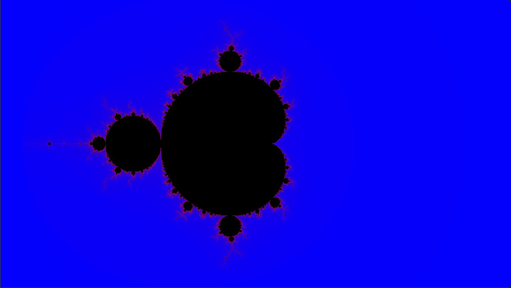

\begin{goals}
- Ein Pixel wie bei einem Funktionsplot auf einen Punkt der Ebene abbilden.
- Für jedes Pixel eine Folge komplexer Zahlen berechnen und das Ergebnis als Farbe ausgeben.
- Erklären, wie die Zahl der Iterationen das Bild der Menge verändert.
\end{goals}

\begin{prerequisites}
Kapitel 2 der Vorlesung, vor allem die 2D-Funktionsplots mit der Julia- und der Mandelbrot-Menge. Die Übung „Metabälle“.

Weiterführend: die [Kurzreferenz zu OpenGL ES 3.0](https://www.khronos.org/files/opengles3-quick-reference-card.pdf) mit GLSL ES 3.00 auf den letzten Seiten.
\end{prerequisites}

## Eine Zahl für jedes Pixel

Wie bei den 2D-Funktionsplots in Kapitel 2 steht jedes Pixel für einen Punkt eines Ausschnitts der Ebene. Hier ist es die Ebene der komplexen Zahlen: Der Punkt $(x, y)$ ist die Zahl $c = x + y\,i$. Die Uniforms `xmin`, `xmax`, `ymin` und `ymax` begrenzen den Ausschnitt, den die Demo zeigt.

## Die Mandelbrot-Menge

Zu jeder Zahl $c$ gehört eine Folge (Kapitel 2, 2D-Funktionsplots – Julia-Menge). Sie beginnt bei $z_0 = 0$, und jedes Glied ist das Quadrat des vorigen plus $c$:

$$
z_{n+1} = z_n^2 + c
$$

Bei manchen $c$ konvergiert die Folge, ihre Glieder bleiben also endlich. Bei anderen divergiert sie und wächst über jede Grenze. Die Mandelbrot-Menge enthält alle $c$, deren Folge konvergiert. Sobald $|z_n| > 2$ ist, divergiert die Folge sicher, und das erste solche $n$ ist die Iterationszahl von $c$. Ein Shader kann nur endlich viele Iterationen berechnen, höchstens $N$.

Vor deinem Code zeigt die Demo `uv` als Rot und Grün.

\demo{mandelbrot}[mandelbrot.frag]

\begin{task}[Mandelbrot-Menge]
Der Shader steht links im Editor und in \vscode{src/mandelbrot/mandelbrot.frag}[mandelbrot.frag]. `maxIterations` ist $N$.

Berechne in `main` die Zahl $c$ des Fragments wie bei den 2D-Funktionsplots. Schreibe die Funktion `mandelbrot`, die die Iterationszahl $n$ von $c$ mit höchstens $N$ Iterationen berechnet, oder 0, wenn die Folge dabei nicht divergiert.

Färbe das Fragment mit `insideColor`, wenn seine Folge nicht divergiert. Sonst färbe es mit einem Verlauf von Blau nach Rot, bei dem $n / N$ angibt, wie weit es Richtung Rot liegt.

1. Welche Form hat die Fläche in `insideColor` bei $N = 1$, und welche Farbe haben die Pixel außerhalb? Prüfe.
2. Stelle $N$ nacheinander auf 1, 2, 3, 5, 10, 20, 50 und 100. Wo im Bild wechseln Pixel von `insideColor` in den Verlauf?
3. Was weißt du über eine Zahl $c$, deren Pixel bei $N = 1000$ in `insideColor` erscheint?

\begin{solution}

\end{solution}
\end{task}

## Eigene Bilder

Ein Verlauf und eine Farbe für innen sind nur eine Möglichkeit. Dieselbe Folge liefert mit kleinen Änderungen ganz andere Bilder: andere Farben, Farbringe wie bei den Metabällen, die Julia-Mengen aus der Vorlesung oder Folgen mit einer anderen Potenz. Hier ist Platz, das auszuprobieren.

\demo{playground}[playground.frag]

\begin{task}[Deine Mandelbrot-Menge (optional)]
Gestalte in \vscode{src/playground/playground.frag}[playground.frag] deine eigenen Bilder. Übernimm dazu, was du aus `mandelbrot.frag` brauchst, und für Farbringe oder einen wechselnden Buntton eventuell deine Farbgebung aus `psychedelic.frag` der Übung „Metabälle“. Bereit stehen `color1`, `color2`, `color3`, die Größe der Canvas in Pixeln als `size` und `juliaC`: Für die Julia-Menge aus der Vorlesung ist $c = x_c + y_c\,i$ fest und wird mit den Reglern „Julia c: x“ und „Julia c: y“ eingestellt, und das Pixel bestimmt $z_0$.

Ideen: ein Verlauf zwischen den Farben mit `mix`, ein Buntton, der sich mit der Iterationszahl wiederholt, $|z|$ für die Punkte der Menge auf den Buntton abbilden wie in der Vorlesung, die Julia-Menge zu `juliaC`, mehrere Abtastwerte pro Pixel wie bei den 2D-Funktionsplots, wofür `size` die Größe eines Pixels liefert, oder $z^3$ statt $z^2$.
\end{task}

\begin{summary}
Beschreibe in eigenen Worten, was du auf dieser Seite gelernt hast und wie du es umgesetzt hast. Save speichert deinen Text in \vscode{summary.md}[summary.md].

\textfield{summary.md}
\end{summary}

\begin{quiz}
Bei jeder Frage ist mindestens eine Antwort richtig, aber auch mehrere Antworten können richtig sein.

\begin{question}
Ein Ausschnitt reicht von $x_{\text{min}} = -2$ bis $x_{\text{max}} = 1$ und wird auf $W = 301$ Pixel abgebildet. Welches $x$ gehört nach den 2D-Funktionsplots in Kapitel 2 zur Pixelspalte 100?
- [ ] $-1.5$
- [ ] $0$
- [x] $-1$
- [ ] $-1.003$
\end{question}

\begin{question}
Was entscheidet, ob eine Zahl $c$ zur Mandelbrot-Menge gehört?
- [ ] die Farbe ihres Pixels
- [x] ob ihre Folge konvergiert
- [ ] wie weit ihr Pixel von der Mitte der Canvas entfernt ist
- [ ] die Zahl der Iterationen $N$
\end{question}

\begin{question}
Welche Aussagen über die Fragmente stimmen, wenn der Shader die Mandelbrot-Menge zeichnet?
- [ ] Ein Fragment braucht die Ergebnisse seiner Nachbarn.
- [x] Jedes Fragment berechnet die Folge seiner eigenen Zahl $c$.
- [ ] Alle Fragmente rechnen gleich viele Iterationen.
- [x] Kein Fragment rechnet mehr als $N$ Iterationen.
\end{question}

\begin{question}
Warum darf ein Fragment aufhören, sobald $|z_n| > 2$ ist?
- [x] Danach divergiert die Folge sicher, das Ergebnis steht also fest.
- [ ] Die Canvas zeigt keine Zahlen mit einem Betrag über 2.
- [ ] Ein `float` kann keine größeren Zahlen speichern.
- [ ] Danach konvergiert die Folge sicher.
\end{question}

\begin{question}
Was unterscheidet die Julia-Menge von der Mandelbrot-Menge?
- [ ] Sie benutzt eine andere Folge als $z_{n+1} = z_n^2 + c$.
- [ ] Bei ihr bestimmt das Pixel die Zahl $c$.
- [x] Bei ihr ist $c$ für alle Pixel gleich, und das Pixel bestimmt $z_0$.
- [ ] Sie hat keine Punkte, deren Folge divergiert.
\end{question}
\end{quiz}
