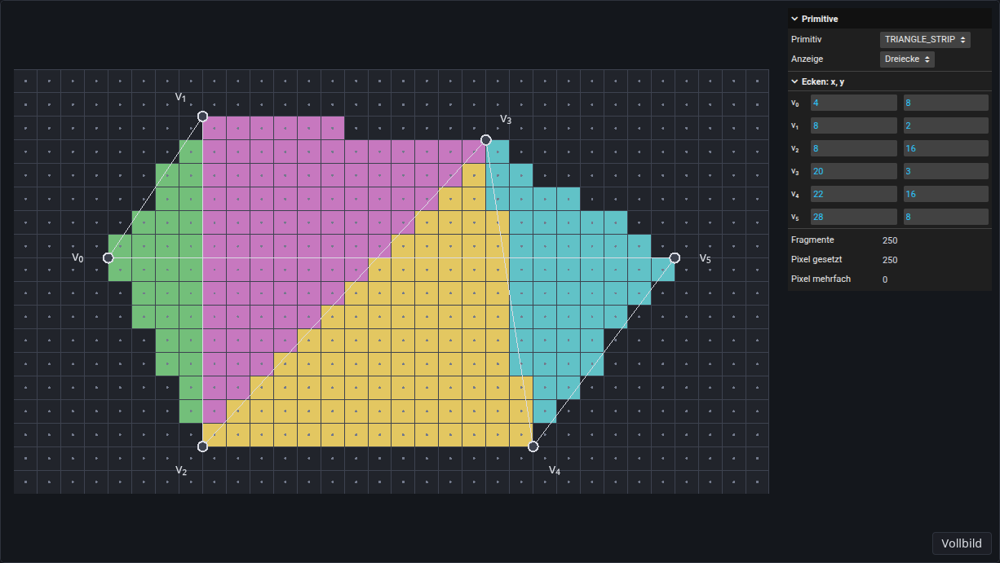
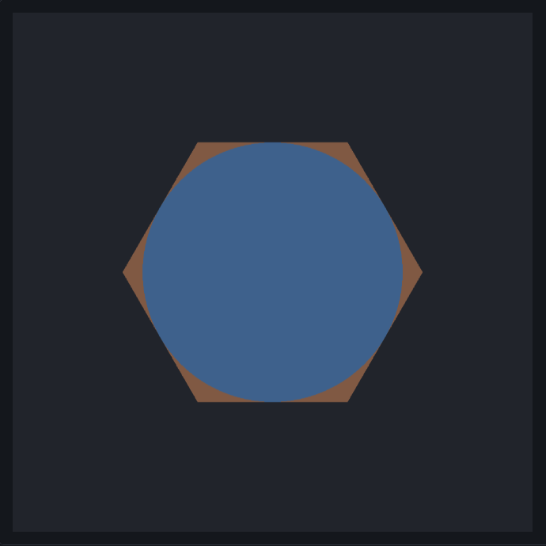

\begin{goals}
- Beschreiben, welche Dreiecke die GPU aus den Eckpunkten eines Vertex-Arrays als Dreiecke, Dreiecksstreifen und Dreiecksfächer bildet.
- Begründen, wann ein Dreiecksfächer ein Polygon genau abdeckt.
- Erklären, wie oft der Fragment-Shader läuft, wenn ein Kreis mit `discard` aus einem Quadrat entsteht.
- Die Zeit zum Zeichnen im Browser messen und erklären, warum einfache Messungen täuschen.
- Messen und erklären, wie die Zeit für einen Dreiecksfächer mit der Zahl seiner Eckpunkte wächst.
\end{goals}

\begin{prerequisites}
Die Übung „Dreiecksrasterisierung“. Kapitel 3 der Vorlesung, vor allem die Primitive der Rasterisierung, die implizite Funktion des Kreises aus der Kreisrasterisierung, die Dreiecksrasterisierung mit Bounding Box und die OpenGL-Rasterisierungspipeline. Aus Kapitel 1 die Bildwiederholrate beim Rendering in Echtzeit.

Weiterführend: [Primitive in OpenGL](https://www.khronos.org/opengl/wiki/Primitive) im Khronos-Wiki und [performance.now()](https://developer.mozilla.org/de/docs/Web/API/Performance/now) bei MDN.
\end{prerequisites}

## Dreiecke, Dreiecksstreifen, Dreiecksfächer

GPUs rasterisieren Primitive: Punkte, Linien, Dreiecke, Dreiecksfächer und Dreiecksstreifen (Kapitel 3, Rasterisierung). Ein Polygon wird deshalb vor der Rasterisierung in Dreiecke zerlegt. Davon hängt ab, wie viele Eckpunkte im Vertex-Array stehen, wie oft der Vertex-Shader läuft und ob jedes Pixel des Polygons genau ein Fragment bekommt.

Die Demo zeigt ein Sechseck auf dem Raster aus der Übung „Dreiecksrasterisierung“. Die GPU zeichnet seine Ecken $v_0, \dots, v_5$ mit einem einzigen Aufruf von `drawArrays` als das Primitiv, das unter „Primitiv“ gewählt ist, und jedes Dreieck bekommt eine eigene Farbe. Die Anzeige „Fragmente pro Pixel“ zeigt stattdessen, wie viele Fragmente jedes Pixel bekommt: je mehr, desto heller. Rechts stehen die Zahl aller Fragmente, der gesetzten Pixel und der Pixel mit mehr als einem Fragment. Die Ecken lassen sich rechts eingeben oder mit der Maus ziehen.

\begin{webgl}
Das erste Argument von `drawArrays` wählt das Primitiv: `gl.TRIANGLES`, `gl.TRIANGLE_STRIP` oder `gl.TRIANGLE_FAN`.

Die Demo färbt jedes Dreieck nach seinem letzten Eckpunkt. Der Vertex-Shader gibt dazu die Nummer `gl_VertexID` des Eckpunkts im Vertex-Array in einer `flat out`-Variable weiter. `flat` heißt, dass der Wert nicht interpoliert wird: Alle Fragmente eines Dreiecks bekommen den Wert seines letzten Eckpunkts. In der Anzeige „Fragmente pro Pixel“ ist die Verblendung mit dem Framebuffer-Inhalt eingeschaltet (Kapitel 3, Rasterisierung – Prozessschritte): Jedes Fragment addiert seine Farbe zu der Farbe, die das Pixel schon hat.
\end{webgl}

\demo{primitives}

\begin{task}[Primitive]
1. „Primitiv“ steht auf TRIANGLE_FAN. Wie viele Dreiecke entstehen, welchen Eckpunkt haben alle gemeinsam, und wie viele Eckpunkte bräuchte TRIANGLES für dieselben Dreiecke?
2. Ziehe $v_3$ zuerst nach $(16, 8)$ und dann nach $(10, 3)$. Das Polygon ist beide Male nicht mehr konvex. In welchem Fall deckt der Fächer es noch genau ab, und welches Dreieck hat im anderen Fall eine andere Winding Order als die übrigen? Ziehe $v_3$ danach zurück nach $(28, 8)$.
3. Schalte auf TRIANGLE_STRIP. Welche Dreiecke entstehen jetzt, und warum decken sie das Sechseck nicht ab? Finde eine Reihenfolge der sechs Ecken im Vertex-Array, in der der Streifen das Sechseck genau abdeckt. Trage ihre Koordinaten in dieser Reihenfolge in die Zeilen $v_0$ bis $v_5$ der Tabelle ein und prüfe mit „Fragmente“ und „Pixel mehrfach“.

\begin{solution}

\end{solution}
\end{task}

## Kreis aus einem Quadrat

Ein Kreis mit Mittelpunkt $M = (x_m, y_m)$ und Radius $r$ ist durch die implizite Funktion

$$
F(x, y) = (x - x_m)^2 + (y - y_m)^2 - r^2
$$

gegeben (Kapitel 3, Kreisrasterisierung). Innerhalb des Kreises ist $F < 0$, außerhalb $F > 0$. Die GPU rasterisiert keine Kreise. Ein Kreis lässt sich aber durch Dreiecke annähern, oder er wird aus einem Quadrat geschnitten: Die GPU rasterisiert das Quadrat aus zwei Dreiecken, und der Fragment-Shader verwirft jedes Fragment, dessen Pixelzentrum außerhalb des Kreises liegt (Kapitel 3, OpenGL-Rasterisierungspipeline).

```glsl
in vec2 point;        // pixel centre of the fragment, in pixel coordinates
uniform vec2 m;       // centre M
uniform float radius; // radius r
out vec4 fragColor;

void main() {
    vec2 d = point - m;
    float F = d.x * d.x + d.y * d.y - radius * radius;
    if (F > 0.0) {
        discard;
    }
    fragColor = vec4(0.36, 0.62, 0.93, 1.0);
}
```

`point` ist die Position in Pixelkoordinaten, die der Vertex-Shader für jeden Eckpunkt weitergibt. Interpoliert ergibt sie für jedes Fragment genau sein Pixelzentrum.

Die Schritt-für-Schritt-Ansicht zeigt ein Quadrat um den Kreis mit $M = (7, 6)$ und $r = 5$ und geht seine Fragmente der Reihe nach durch. Die GPU führt den Fragment-Shader für viele Fragmente zugleich aus; die Reihenfolge dient nur der Anschauung.

\stepper{circle}

\begin{task}[Kreis aus einem Quadrat]
1. Wie oft läuft der Fragment-Shader für das Quadrat, wie viele Pixel werden gesetzt, und welcher Anteil der Aufrufe setzt kein Pixel?
2. Welcher Anteil der Aufrufe setzt kein Pixel, wenn $r$ sehr groß wird? Wie viele Eckpunkte braucht das Quadrat dabei?
3. Warum stimmt das Bild an jedem Pixelzentrum genau mit dem Kreis überein, obwohl die GPU nur zwei Dreiecke rasterisiert?
\end{task}

## Zeit messen

Ein berechnetes Bild heißt Frame (Kapitel 1, Rendering Pipeline), und die Bildwiederholrate gibt an, wie viele Frames pro Sekunde (fps) entstehen (Kapitel 1, Rendering in Echtzeit). Wie lange ein Frame dauert, hängt davon ab, wie viel Arbeit die Stufen der Pipeline haben (Kapitel 3, OpenGL Rendering Pipeline – Rasterisierungsstufe). Der Vertex-Shader läuft einmal pro Eckpunkt. Triangle Setup und Triangle Traversal arbeiten pro Dreieck; in der Dreiecksrasterisierung der Vorlesung werden dabei die Pixelzentren in der Bounding Box des Dreiecks getestet (Kapitel 3, Dreiecksrasterisierung). Der Fragment-Shader und das Merging mit dem Color-Buffer laufen einmal pro Fragment.

\begin{note}[Über die Vorlesung hinaus: Zeit messen im Browser]
WebGL-Aufrufe wie `drawArrays` stellen Befehle nur in eine Warteschlange. Die GPU führt sie später aus, während das Programm schon weiterläuft; die Zeit um die Aufrufe misst deshalb nur, wie lange das Einreihen dauert. Außerdem kostet jeder Aufruf von `drawArrays` einen festen Anteil, unabhängig davon, was er zeichnet. `requestAnimationFrame` ruft seine Funktion einmal pro Bild des Bildschirms auf, also höchstens so oft, wie der Bildschirm Bilder pro Sekunde zeigt, meist 60.

`readPixels` in ein Array muss warten, bis die GPU alle Befehle davor ausgeführt hat; liest es nur ein Pixel, kostet es darüber hinaus kaum Zeit. `gl.finish()` wartet nicht in jedem Browser.

`performance.now()` gibt die Zeit in Millisekunden an, aber in Schritten von 0,1 ms (Chrome) oder 1 ms (Firefox, Safari). Eine Messung zeichnet deshalb dasselbe $K$-mal und dauert einige zehn Millisekunden. Die GPU taktet nach ihrer Auslastung: Die ersten Messungen und Messungen mit wenig Arbeit laufen oft langsamer, und Shader werden erst beim ersten Zeichnen fertig übersetzt. Gemessen wird daher erst nach einer kurzen Aufwärmzeit und mehrmals, und der Median zählt, weil einzelne Messungen manchmal viel länger dauern als die übrigen. Eine leere Messung, die nur wartet, ergibt die Zeit für das Warten selbst; sie wird abgezogen.

Gezeichnet wird in einen Framebuffer fester Größe, weil die Größe der Canvas vom Fenster abhängt. Manche GPUs lassen Fragmente aus, die ein späteres, undurchsichtiges Fragment überdeckt; mit eingeschalteter Verblendung wird jedes Fragment verarbeitet. Eine Messung bleibt weit unter einer Sekunde: Bekommt die GPU zu viel Arbeit auf einmal, kann der Browser den WebGL-Kontext verlieren, und `gl.isContextLost()` wird `true`. Die Ergebnisse unterscheiden sich zwischen GPUs, Browsern und Betriebssystemen.

```ts
const pixel = new Uint8Array(4);
const start = performance.now();
for (let k = 0; k < K; k++) {
    gl.drawArrays(gl.TRIANGLES, 0, vertexCount);
}
gl.readPixels(0, 0, 1, 1, gl.RGBA, gl.UNSIGNED_BYTE, pixel);
const time = performance.now() - start;
```
\end{note}

Die Demo zeichnet $K$ Quadrate („Quadrate“) mit der Seitenlänge $s$ in Pixeln in einen Framebuffer aus $1024 \times 1024$ Pixeln, alle an derselben Stelle und jedes mit einem eigenen Aufruf von `drawArrays`, mit eingeschalteter Verblendung. Jedes Quadrat besteht aus gleich großen Dreiecken, abwechselnd gefärbt; die Zahl der Fragmente hängt nicht davon ab, wie viele es sind. Nach jeder Änderung misst die Demo einmal mit dem gewählten Verfahren. „Bildwiederholrate“ zeichnet die Quadrate eine Sekunde lang in jedem Frame und zählt die Frames. „Ohne Warten“ misst nur die Aufrufe. „Mit readPixels“ misst wie im Listing, nach einer Aufwärmzeit neunmal; „Zeit pro Messung“ ist der Median, und für „Zeit pro Quadrat“ wird vorher eine leere Messung abgezogen. „Streuung“ ist der Abstand zwischen der längsten und der kürzesten der neun Messungen, bezogen auf den Median. Bei mehr als $2^{25}$ Dreiecken oder wenn eine Messung länger als 250 ms dauert, misst die Demo nicht und zeigt das unter „Status“.

\demo{timing}

\begin{task}[Zeit messen]
1. Stelle „Verfahren“ auf „Bildwiederholrate“ und „Seitenlänge“ auf 1024, und erhöhe „Quadrate“ schrittweise. Bis zu welcher Zahl von Quadraten zeigt „fps“ die Bildwiederholrate deines Bildschirms, meist 60 fps? Warum sagt dieser Wert nichts darüber, wie lange das Zeichnen dauert?
2. Stelle „Mit readPixels“, Seitenlänge 1024 und die größte Zahl an Quadraten ein, bei der die Demo noch misst, und vergleiche mit „Ohne Warten“. Halbiere danach die Seitenlänge. Warum ist die Zeit ohne Warten so viel kleiner, und warum ändert sie sich mit der Seitenlänge kaum?
3. Stelle „Mit readPixels“, Seitenlänge 1024 und 1024 Quadrate ein. Erhöhe dann „Dreiecke pro Quadrat“ schrittweise. Ab welcher Zahl wächst die Zeit deutlich, obwohl die Fragmente gleich bleiben? Wie viele Pixel bedeckt ein Dreieck dort, und welche Arbeit wächst mit der Zahl der Dreiecke?
\end{task}

## Eigene Umsetzung

\begin{task}[Dreiecksfächer messen]
Schreibe ein Programm, das ein regelmäßiges Polygon mit $n$ Ecken auf der CPU als Dreiecksfächer erzeugt, es mit einem Vertex- und einem Fragment-Shader zeichnet und misst, wie die Zeit zum Zeichnen mit $n$ wächst. Rufe deinen Code aus \vscode{src/solution/index.ts}[start] auf; das Ergebnis erscheint in der Demo unter dieser Aufgabe.

Das Ergebnis soll das Polygon für ein einstellbares $n$ so zeigen, dass der Kreis mit Radius $r$ um den Mittelpunkt des Polygons jede Seite des Polygons berührt. Gemessen wird die Zeit pro Fächer für $n$ von 3 bis mindestens 65 536, für $r = 256$ und $r = 128$ Pixel, in einem Raster fester Größe, in das auch das Polygon für $n = 3$ ganz hineinpasst.

Trage deine Messwerte in \vscode{src/results/results.json}[results.json] ein, als Liste von Zeilen mit einem Wert pro Spalte, zum Beispiel `[{ "n": 3, "r = 256 (µs)": 4.1, "r = 128 (µs)": 1.2 }]`. Die Tabelle unter der Demo zeigt sie an.

1. Ab welchem $n$ liegen weniger als 1 % der Fragmente deines Polygons außerhalb des Kreises?
2. In welchem Bereich von $n$ liegt die Zeit pro Fächer höchstens 10 % über ihrem Minimum? Miss dafür auch viele kleine $n$.
3. Warum fällt die Zeit zuerst und steigt später?
4. Was ändert sich mit $r = 128$, für kleine und für große $n$?

\begin{solution}

\end{solution}
\end{task}

\demo{solution}

\demo{results}

\begin{task}[Andere Zerlegungen (optional)]
Nähere denselben Kreis auf andere Weise an und vergleiche die Zeiten mit deinem Fächer. Ideen: dieselben Dreiecke mit `gl.TRIANGLES` statt `gl.TRIANGLE_FAN`, ein Dreiecksstreifen, der zwischen zwei Seiten des Polygons hin- und herwechselt, das Quadrat mit `discard`, andere Zerlegungen wie in [Triangulation](http://www.humus.name/index.php?page=News&ID=228) von Emil Persson, und in Chrome die Zeit der GPU selbst mit der Erweiterung `EXT_disjoint_timer_query_webgl2`.
\end{task}

\begin{summary}
Beschreibe in eigenen Worten, was du auf dieser Seite gelernt hast und wie du es umgesetzt hast. Save speichert deinen Text in \vscode{summary.md}[summary.md].

\textfield{summary.md}
\end{summary}

\begin{quiz}
Bei jeder Frage ist mindestens eine Antwort richtig, aber auch mehrere Antworten können richtig sein.

\begin{question}
Ein Vertex-Array mit 10 Eckpunkten wird mit `gl.TRIANGLE_FAN` gezeichnet. Was stimmt?
- [ ] Es entstehen 10 Dreiecke.
- [x] Es entstehen 8 Dreiecke.
- [ ] Es entstehen 3 Dreiecke.
- [x] Alle Dreiecke enthalten den ersten Eckpunkt.
\end{question}

\begin{question}
Welche Dreiecke entstehen mit `gl.TRIANGLE_STRIP` aus den Eckpunkten $v_0, \dots, v_4$?
- [x] $\{v_0, v_1, v_2\}$, $\{v_1, v_2, v_3\}$, $\{v_2, v_3, v_4\}$
- [ ] $\{v_0, v_1, v_2\}$, $\{v_0, v_2, v_3\}$, $\{v_0, v_3, v_4\}$
- [ ] nur $\{v_0, v_1, v_2\}$
- [ ] $\{v_0, v_1, v_2\}$, $\{v_2, v_3, v_4\}$
\end{question}

\begin{question}
Ein Polygon wird als Dreiecksfächer ab $v_0$ gezeichnet, seine Ecken stehen der Reihe nach im Vertex-Array. Was stimmt?
- [ ] Ein Fächer braucht einen Eckpunkt in der Mitte des Polygons.
- [x] Ist das Polygon konvex, bekommt jedes seiner Pixel genau ein Fragment.
- [ ] Der Fächer deckt jedes solche Polygon genau ab.
- [x] Hat ein Dreieck des Fächers eine andere Winding Order als die übrigen, können Pixel mehrere Fragmente bekommen.
\end{question}

\begin{question}
Ein Programm misst mit `performance.now()` die Zeit um 1000 Aufrufe von `drawArrays`, ohne danach zu warten. Was misst es?
- [x] wie lange es dauert, die Befehle in die Warteschlange zu stellen
- [ ] wie lange die GPU zum Zeichnen braucht
- [ ] wie lange ein Frame dauert
- [ ] die Zeit pro Fragment
\end{question}

\begin{question}
Das Zeichnen eines Frames dauert 4 ms, der Bildschirm zeigt 60 Bilder pro Sekunde. Welche Bildwiederholrate misst ein Programm, das mit `requestAnimationFrame` zeichnet und die Frames zählt?
- [ ] 250 fps
- [ ] 125 fps
- [x] 60 fps
- [ ] 16 fps
\end{question}

\begin{question}
Ein Quadrat aus 2 Dreiecken wird durch 2048 gleich große Dreiecke ersetzt, die dieselbe Fläche abdecken, und mit `gl.TRIANGLES` gezeichnet. Was stimmt?
- [x] Die Zahl der Fragmente bleibt gleich.
- [ ] Der Fragment-Shader läuft 1024-mal so oft.
- [x] Der Vertex-Shader läuft 6144-mal statt 6-mal.
- [ ] Die Zeit bleibt sicher gleich, weil die Fragmente gleich bleiben.
\end{question}

\begin{question}
Ein Kreis mit großem Radius entsteht aus einem Quadrat, dessen Fragmente außerhalb des Kreises der Fragment-Shader verwirft. Welcher Anteil der Aufrufe des Fragment-Shaders setzt ungefähr kein Pixel?
- [ ] 0 %, weil der Fragment-Shader für verworfene Fragmente nicht läuft
- [ ] 50 %
- [ ] 78,5 %
- [x] 21,5 %
\end{question}

\begin{question}
`performance.now()` hat Schritte von 1 ms. Wie lange muss eine Messung mindestens dauern, damit ein Schritt höchstens etwa 3 % von ihr ausmacht?
- [ ] 1 ms
- [ ] 3 ms
- [ ] etwa 300 ms
- [x] etwa 30 ms
\end{question}

\begin{question}
Das Dreieck mit den Ecken $(0, 0)$, $(64, 63)$ und $(63, 64)$ wird mit Edge Function Testing in seiner Bounding Box rasterisiert. Was stimmt ungefähr?
- [ ] Es werden rund 64 Pixelzentren getestet.
- [x] Es werden rund 4100 Pixelzentren getestet.
- [x] Es entstehen rund 64 Fragmente.
- [ ] Es entstehen rund 2000 Fragmente.
\end{question}
\end{quiz}
