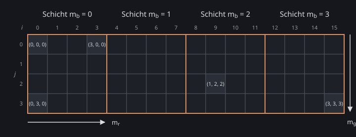

\begin{goals}
- Erklären, warum sich eine Farbraum-Transformation, die nur die Farbe eines Pixels braucht, als Lookup Table vorberechnen lässt.
- Eine 3D-LUT lesen und erzeugen, die als Bild mit $N^2 \times N$ Pixeln gespeichert ist.
- Eine 3D-LUT mit Nearest und mit trilinearer Interpolation auf ein Bild anwenden.
\end{goals}

\begin{prerequisites}
Kapitel 2 der Vorlesung, vor allem das RGB-Farbmodell, die Farbraum-Transformationen, die Farbquantisierung und das Resampling mit GPU und Texturing. Die Übung „Bildfilter auf CPU und GPU“ für Texturen, Texturkoordinaten und das Laden von Bildern.

Weiterführend: [Using Lookup Tables to Accelerate Color Transformations](https://developer.nvidia.com/gpugems/gpugems2/part-iii-high-quality-rendering/chapter-24-using-lookup-tables-accelerate-color) von Jeremy Selan in GPU Gems 2 und die [Kurzreferenz zu OpenGL ES 3.0](https://www.khronos.org/files/opengles3-quick-reference-card.pdf) mit GLSL ES 3.00 auf den letzten Seiten.
\end{prerequisites}

\begin{note}[Über die Vorlesung hinaus: Farb-LUTs]
Die Color Lookup Table der indizierten Bildkodierung in Kapitel 2 bildet einen Index auf eine Farbe ab. Farb-LUTs, die eine Farbe auf eine Farbe abbilden, kommen in der Vorlesung nicht vor; diese Seite baut sie aus dem RGB-Farbmodell, den Farbraum-Transformationen und dem Bilinear Filtering auf.
\end{note}

## Farben nachschlagen

Eine Farbe $c = (r, g, b)$ ist ein Punkt im Einheitswürfel des RGB-Farbmodells (Kapitel 2, RGB-Farbmodell). Eine Farbraum-Transformation berechnet die neue Farbe eines Pixels nur aus seiner eigenen Farbe (Kapitel 2, Farbraum-Transformation). Sie ist also eine Funktion $f: [0, 1]^3 \to [0, 1]^3$, und ihr Ergebnis lässt sich für viele Farben einmal vorberechnen und in einer Tabelle ablegen. Beim Anwenden wird es nur noch nachgeschlagen, egal wie aufwendig $f$ ist. Eine solche Tabelle heißt Lookup Table (LUT).

Die Demo wendet eine der folgenden Operationen auf ein Foto mit wenigen verschiedenen Farben an und zeigt Eingabe und Ausgabe nebeneinander. Fährt die Maus über ein Pixel, werden alle Pixel mit derselben Eingabefarbe hervorgehoben; rechts stehen ihre Anzahl und die Zahl ihrer verschiedenen Ausgabefarben. Die Operationen:

- Gammakorrektur $(r, g, b) \mapsto (r^{1/\gamma}, g^{1/\gamma}, b^{1/\gamma})$ mit $\gamma = 2.2$ (Kapitel 2, Gammakorrektur).
- Kontrastanpassung $I' = M + \alpha (I - M)$ mit der Intensität $I$ nach BT.709, $M = 0.5$ und $\alpha = 1.6$; die Farbe wird mit $\lambda = I' / \max(I, \varepsilon)$ zu $(\lambda r, \lambda g, \lambda b)$ (Kapitel 2, Farbraum-Transformation – Kontrastanpassung).
- Glättung: Jedes Pixel bekommt den Mittelwert seiner Umgebung aus einer gröberen Mipmap-Stufe (Kapitel 2, Resampling-Beispiele).
- Vignette: Jedes Pixel wird umso dunkler, je weiter es von der Bildmitte entfernt ist.

\demo{same-color}

\begin{task}[Nur die Farbe zählt?]
1. Wähle nacheinander jede Operation und fahre über einige Pixel. Bei welchen Operationen bekommen alle Pixel mit derselben Eingabefarbe dieselbe Ausgabefarbe?
2. Wovon hängt die Ausgabe der anderen Operationen außer von der Farbe noch ab, und warum lässt sich für sie keine LUT vorberechnen?
\end{task}

## Der Farbwürfel als Bild

Eine 3D-LUT legt ein regelmäßiges Gitter mit $N$ Punkten pro Achse in den RGB-Würfel, wie das gröbere Gitter der Uniform Color Quantization (Kapitel 2, Farbquantisierung); anders als dort liegen der erste und der letzte Gitterpunkt genau bei 0 und 1. Eintrag $(m_r, m_g, m_b)$ mit $m_r, m_g, m_b \in \{0, \dots, N - 1\}$ speichert die Farbe $f\left(\frac{m_r}{N - 1}, \frac{m_g}{N - 1}, \frac{m_b}{N - 1}\right)$. Die Identität, die jede Farbe auf sich selbst abbildet, speichert an jedem Gitterpunkt seine eigene Farbe. Eine LUT lässt sich auch ohne Formel herstellen: Bearbeitet man das Bild einer Identität in einem Bildbearbeitungsprogramm wie ein Foto, etwa mit Kurven, steht danach an jedem Eintrag, was die Bearbeitung aus seiner Farbe macht. Mit $N = 33$ hat eine 3D-LUT 35 937 Einträge, mit 3 Bytes pro Eintrag rund 105 KiB; ein Eintrag für jede der 16 777 216 Farben mit 8 Bit pro Kanal wären rund 48 MiB.

Als Datei wird eine 3D-LUT hier als Bild mit $N^2 \times N$ Pixeln gespeichert. Jede Schicht mit festem $m_b$ ist ein Quadrat aus $N \times N$ Pixeln, und die Schichten liegen nebeneinander. In einer Schicht wächst $m_r$ nach rechts und $m_g$ nach unten. Eintrag $(m_r, m_g, m_b)$ liegt also an Pixel $(i, j) = (m_b N + m_r, m_g)$, wobei $j = 0$ die oberste Zeile ist.

Eine Farbe $c = (r, g, b)$ liegt im Gitter an der Stelle $(N - 1)\,c$, meist zwischen den Gitterpunkten. Nearest rundet jede der drei Koordinaten auf den nächsten Index und nimmt diesen Eintrag. Die trilineare Interpolation mischt die 8 Einträge an den Ecken der Gitterzelle, in der die Farbe liegt: Die abgerundeten Koordinaten geben die Ecke $(m_r, m_g, m_b)$, ihre Nachkommaanteile $t_r, t_g, t_b$ die Gewichte. Zuerst wird entlang $r$ mit $t_r$ gemischt, das ergibt 4 Farben, dann entlang $g$ mit $t_g$, das ergibt 2, und zuletzt entlang $b$ mit $t_b$. Die ersten beiden Schritte sind das Bilinear Filtering von 2 × 2 Texeln innerhalb einer Schicht (Kapitel 2, Resampling mit GPU und Texturing).

\begin{webgl}
Das Trilinear Filtering aus Kapitel 2 (Resampling mit GPU und Texturing) ist ein anderes Verfahren: Es mischt bilinear gefilterte Werte aus zwei Mipmap-Stufen.
\end{webgl}

Die Demo zeigt die drei LUT-Dateien aus `assets/luts/`: oben eine Schicht vergrößert, unten das ganze Bild mit der Schicht umrandet. Rechts stehen das Pixel unter der Maus und seine Bytes.

\demo{lut-atlas}

\begin{task}[Eine LUT lesen]
1. Wähle „Identität“ ($N = 4$). An welchen Pixeln $(i, j)$ stehen Blau, Magenta, Gelb und Cyan? Leite sie zuerst aus der Formel her und prüfe dann mit „Pixel (i, j)“.
2. Wähle „Rätsel“ ($N = 8$) und lies die Einträge für Rot, Grün, Blau und Gelb ab. Was macht diese LUT mit einem Foto?
\end{task}

## LUTs in der Praxis

\begin{task}[LUTs in der Praxis]
1. Finde zwei Programme oder Geräte, die Farb-LUTs verwenden, etwa aus Videoschnitt, Fotografie oder Spielen. Wofür setzen sie die LUT ein, und in welchem Dateiformat speichern sie sie?
2. Warum wenden diese Programme eine LUT an, statt die Farbänderung für jedes Bild neu zu berechnen? Denke an eine Kette aus mehreren Farbänderungen und an einen Look, der in einem anderen Programm genauso aussehen soll.
\end{task}

## Eigene Umsetzung

\begin{note}[Tipp: Bilder byte-genau laden und speichern]
Lade PNG-Dateien wie in der Übung „Bildfilter auf CPU und GPU“ über `Image`, `drawImage` und `getImageData`; die Bytes bleiben nur erhalten, wenn die Datei kein Farbprofil hat. Zum Speichern schreibst du die Bytes mit `putImageData` in eine Canvas 2D und lädst sie mit `toBlob` und einem Link mit `download` herunter; die Datei kann sich von einer mitgelieferten mit denselben Pixel-Bytes unterscheiden, weil der Browser anders komprimiert. Ein `ImageData` beginnt mit der obersten Bildzeile; `texImage2D` legt sie in die Texturzeile 0, und `readPixels` liefert zuerst die Zeile mit `gl_FragCoord.y` $= 0.5$. Mit LINEAR trifft die Texturkoordinate $\frac{i + 0.5}{W}$ genau die Mitte von Texel $i$ (Übung „Bildfilter auf CPU und GPU“); dazwischen mischt LINEAR die Nachbartexel, am Rand einer Schicht also auch die Nachbarschicht.
\end{note}

\begin{task}[Eigene 3D-LUTs]
Schreibe ein Programm, das eine LUT aus `assets/luts/` auf das Foto `assets/flower.png` anwendet und eine Identitäts-LUT als PNG-Datei speichert. Rufe deinen Code aus \vscode{src/solution/index.ts}[start] auf; das Ergebnis erscheint in der Demo unter dieser Aufgabe.

Das Ergebnis soll das Foto und das gefärbte Foto nebeneinander zeigen, und man soll die LUT und zwischen Nearest und trilinearer Interpolation wählen können. Die LUT liegt auf der GPU als 2D-Textur im Format dieser Seite, nicht als 3D-Textur. Die Identität soll sich für verschiedene $N$ speichern lassen, und die gespeicherte Identität mit $N = 4$ soll nach dem Laden dieselben Pixel-Bytes liefern wie `assets/luts/identitaet-4.png`. Dafür brauchst du aus Kapitel 2 das RGB-Farbmodell, die Farbquantisierung und das Bilinear Filtering.

1. Wende `identitaet-4.png` mit Nearest und mit trilinearer Interpolation an. Welche Bytes kann ein Kanal mit Nearest noch haben? Wie stark weicht dein Ergebnis mit trilinearer Interpolation vom Foto ab, und warum?
2. Wende `raetsel-8.png` mit Nearest und mit trilinearer Interpolation an. Wo unterscheiden sich die beiden Bilder, und warum?

\begin{solution}

\end{solution}
\end{task}

\demo{solution}

\begin{task}[Eigene Looks (optional)]
Bearbeite deine gespeicherte Identität in einem Bildbearbeitungsprogramm wie GIMP oder Krita, etwa mit Kurven oder einer Farbbalance. Exportiere sie ohne Farbprofil, lege sie in `assets/luts/`, lade sie in deinem Programm und wende sie auf das Foto an. Wende danach eine Glättung auf das LUT-Bild an und schau, was an den Rändern der Schichten passiert. Weitere Ideen: eine `.cube`-Datei einlesen oder deine Interpolation mit einer 3D-Textur (`TEXTURE_3D` mit LINEAR) vergleichen.
\end{task}

\begin{summary}
Beschreibe in eigenen Worten, was du auf dieser Seite gelernt hast und wie du es umgesetzt hast. Save speichert deinen Text in \vscode{summary.md}[summary.md].

\textfield{summary.md}
\end{summary}

\begin{quiz}
Bei jeder Frage ist mindestens eine Antwort richtig, aber auch mehrere Antworten können richtig sein.

\begin{question}
Welche Operationen kann eine einzige 3D-LUT für jedes Bild ersetzen?
- [ ] die Glättung
- [x] die Gammakorrektur
- [ ] die Vignette
- [x] die Kontrastanpassung mit festem $M = 0.5$
- [x] die Graustufenumwandlung nach BT.709
\end{question}

\begin{question}
Eine 3D-LUT hat $N = 17$ Einträge pro Achse und 3 Bytes pro Eintrag. Was stimmt?
- [x] Sie braucht rund 14 KiB.
- [ ] Sie hat 289 Einträge.
- [ ] Sie braucht rund 48 MiB.
- [x] Sie hat 4913 Einträge.
\end{question}

\begin{question}
Eine 3D-LUT mit $N = 4$ ist im Format dieser Seite als Bild mit $16 \times 4$ Pixeln gespeichert. Was stimmt über den Eintrag $(m_r, m_g, m_b) = (2, 1, 3)$?
- [ ] Er liegt an Pixel $(13, 2)$.
- [ ] Er liegt an Pixel $(6, 3)$.
- [x] Er liegt in der Schicht ganz rechts.
- [x] Er liegt an Pixel $(14, 1)$.
\end{question}

\begin{question}
Eine 3D-LUT hat $N = 5$. Welcher Eintrag wird mit Nearest für die Farbe $(0.3, 0.6, 0.9)$ gelesen?
- [ ] der Eintrag $(1, 3, 4)$
- [x] der Eintrag $(1, 2, 4)$
- [ ] der Eintrag $(2, 3, 5)$
- [x] der Eintrag an Pixel $(21, 2)$
\end{question}

\begin{question}
Was stimmt über „trilinear“?
- [x] Das Trilinear Filtering aus Kapitel 2 mischt bilinear gefilterte Werte aus zwei Mipmap-Stufen.
- [ ] Die trilineare Interpolation einer 3D-LUT braucht Mipmaps.
- [x] Die trilineare Interpolation einer 3D-LUT mischt die 8 Einträge an den Ecken der Gitterzelle um die Farbe.
- [ ] Beide Begriffe meinen dasselbe Verfahren.
\end{question}
\end{quiz}
