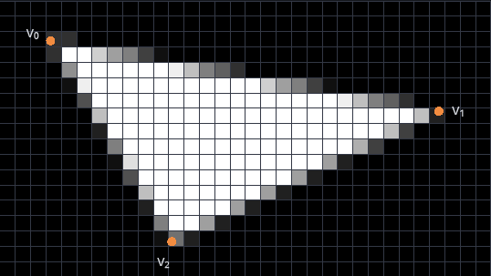
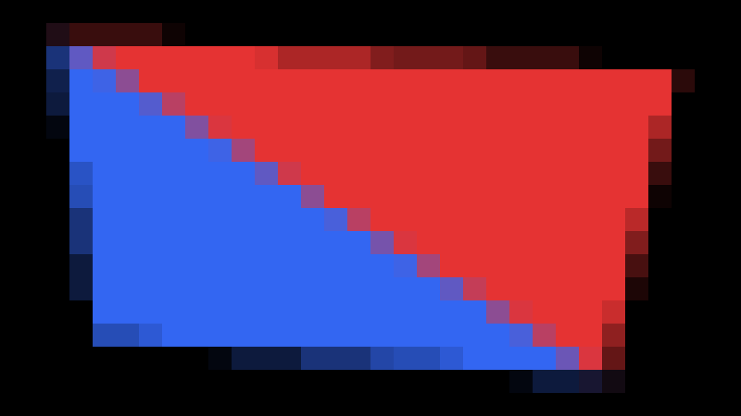
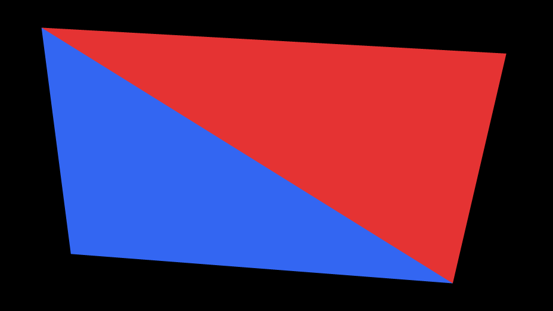

\begin{goals}
- Erklären, wie Aliasing beim Rasterisieren durch die Abtastung an den Pixelzentren entsteht.
- Beschreiben, wie Supersampling die Farbe eines Pixels aus $n \times n$ Samples bestimmt.
- Supersampling auf der GPU und auf der CPU umsetzen.
\end{goals}

\begin{prerequisites}
Kapitel 3 der Vorlesung, vor allem das Aliasing und die Dreiecksrasterisierung mit Edge Function Testing. Aus Kapitel 2 der Box-Filter. Die Übung „Dreiecksrasterisierung“.

Weiterführend: [High-Quality Antialiased Rasterization](https://developer.nvidia.com/gpugems/gpugems2/part-iii-high-quality-rendering/chapter-21-high-quality-antialiased-rasterization) von Dan Wexler und Eric Enderton in GPU Gems 2 und die [Kurzreferenz zu OpenGL ES 3.0](https://www.khronos.org/files/opengles3-quick-reference-card.pdf) mit GLSL ES 3.00 auf den letzten Seiten.
\end{prerequisites}

\begin{note}[Über die Vorlesung hinaus: Supersampling]
Kapitel 3 zeigt unter „Aliasing“ eine Rasterisierung ohne und mit Antialiasing, erklärt aber kein Verfahren dafür. Diese Seite baut das Supersampling aus der Abtastung an den Pixelzentren und dem Box-Filter auf.
\end{note}

## Aliasing beim Rasterisieren

Die Dreiecksrasterisierung tastet ein Dreieck nur an den Pixelzentren ab (Übung „Dreiecksrasterisierung“): Liegt das Pixelzentrum im Dreieck, bekommt das Pixel die Farbe des Dreiecks, sonst bleibt es, wie es ist. Ein Pixel gehört also ganz oder gar nicht zum Dreieck, egal wie viel seiner Fläche das Dreieck bedeckt. Das Abtasten nur am Pixelzentrum ist eine Abtastung, das Ganz-oder-gar-nicht eine Quantisierung, und aus beiden entsteht Aliasing (Kapitel 3, Rasterisierung – Aliasing): Das Bild auf dem Raster weicht vom Dreieck ab, und zwar umso stärker, je gröber das Raster ist. Verfahren, die diese Aliasing-Artefakte verringern, heißen Antialiasing.

Die Demo rasterisiert ein weißes Dreieck in ein Raster aus $32 \times 18$ Pixeln. Die Punkte sind die Pixelzentren, die Linie ist der genaue Umriss. „Dreieck“ wählt ein großes oder ein schmales Dreieck, die Eckpunkte (vertices) lassen sich rechts eingeben oder mit der Maus ziehen, und „Verschiebung“ schiebt das Dreieck nach rechts. Rechts stehen die Zahl der gesetzten Pixel und die Fläche des Dreiecks in Pixeln.

\demo{aliasing}

\begin{task}[Ein Sample pro Pixel]
1. Ziehe „Verschiebung“ langsam von 0 bis 1 und beobachte ein Pixel an der Kante zwischen $v_0$ und $v_2$. In welchem Moment wechselt es zwischen Schwarz und Weiß?
2. Wähle „Schmal“ und ziehe „Verschiebung“ noch einmal. Wie weit weicht „Gesetzte Pixel“ dabei von „Fläche“ ab?
3. Warum zerfällt das schmale Dreieck in einzelne Stücke, obwohl es zusammenhängt?
\end{task}

## Supersampling

Supersampling tastet jedes Pixel an mehreren Stellen ab. Mit $n \times n$ Samples pro Pixel liegen die Samples von Pixel $(i, j)$ auf einem regelmäßigen Gitter:

$$
\left(i + \frac{a + 0.5}{n},\ j + \frac{b + 0.5}{n}\right), \qquad a, b \in \{0, \dots, n - 1\}.
$$

Das sind genau die Pixelzentren eines Rasters, das in jeder Richtung $n$-mal so fein ist. Die GPU kann das Dreieck also wie gewohnt in ein Raster aus $32n \times 18n$ Pixeln rasterisieren. Danach bekommt jedes Pixel des eigentlichen Rasters den Mittelwert seiner $n \times n$ Samples. Das ist ein Box-Filter über die Samples (Kapitel 2, Bildfaltung – Glättung); anders als dort wird jeder Block aus $n \times n$ Samples zu einem einzigen Pixel des groben Rasters. Mit $n = 1$ bleibt nur das Pixelzentrum, wie ohne Supersampling. Mit $n \times n$ Samples läuft der Fragment-Shader des Dreiecks etwa $n^2$-mal so oft.

\begin{webgl}
Kapitel 2 (Raster – Koordinatensysteme) nennt das Abtasten an $(i + 0.5, j + 0.5)$ Subsampling. Supersampling heißt dagegen, mehrere Samples pro Pixel zu nehmen.

Eine WebGL-Canvas glättet Kanten normalerweise selbst: `getContext` fordert mit `antialias: true`, der Voreinstellung, das Multisampling der GPU an (MSAA), wie `antialias: true` in den three.js-Beispielen in Kapitel 1 (High-Level API three.js). Es testet mehrere Samples pro Pixel, führt den Fragment-Shader aber nur einmal pro Pixel und Dreieck aus. Die Demos dieser Seite schalten es mit `antialias: false` aus.
\end{webgl}

Die Demo rasterisiert dasselbe Dreieck mit $n \times n$ Samples pro Pixel. „Samples“ zeigt die Samples, weiß im Dreieck und grau außerhalb, und darüber das Gitter der Pixel; „Ergebnis“ zeigt das Raster, das `resolve.frag` daraus schreibt. Rechts stehen das Pixel, über dem die Maus zuletzt war, wie viele seiner Samples im Dreieck liegen und seine Bytes im Ergebnis.

\demo{supersampling}[resolve.frag]

\begin{task}[Mehrere Samples pro Pixel]
1. Wähle „Samples“ und $n = 2$, zeige mit der Maus auf ein Pixel an der Kante zwischen $v_0$ und $v_2$ und ziehe „Verschiebung“ langsam von 0 bis 1. Wie ändert sich die Zahl seiner Samples im Dreieck?
2. Wie viele verschiedene Intensitäten kann ein Pixel mit $n \times n$ Samples bekommen, wenn ein weißes Dreieck auf schwarzem Hintergrund liegt?
3. Welchem Wert nähert sich der Anteil der Samples eines Pixels, die im Dreieck liegen, wenn $n$ wächst?
\end{task}

\begin{task}[Mittelwert der Samples]
Die Demo rasterisiert das Dreieck in eine Textur `samples` mit $n \times n$ Texeln pro Pixel. Der Fragment-Shader \vscode{src/supersampling/resolve.frag}[resolve.frag] läuft einmal für jedes Pixel des Rasters und nimmt bisher nur ein Sample.

Ändere `resolve.frag` so, dass jedes Pixel den Mittelwert seiner $n \times n$ Samples bekommt.

1. Wähle „Ergebnis“ und ziehe „Verschiebung“ einmal mit $n = 1$ und einmal mit $n = 4$. Wie bewegen sich die Kanten jeweils?
2. Wähle „Schmal“ und ziehe „Verschiebung“ mit $n = 4$. Was wird aus den einzelnen Stücken aus der Aufgabe „Ein Sample pro Pixel“?
3. Wähle „Samples“ und schau dir das schmale Dreieck nahe $v_0$ an. Wo bedeckt es Teile eines Pixels, ohne eines seiner Samples zu treffen, und warum?

\begin{solution}

\end{solution}
\end{task}

## Eigene Umsetzung

\begin{note}[Tipp: Ein Raster der CPU anzeigen]
Schreibe die Bytes deines Rasters mit `putImageData` in eine Canvas 2D mit $32 \times 18$ Pixeln, die nicht auf der Seite steht, und zeichne sie mit `drawImage` vergrößert in die Canvas der Demo. Mit `imageSmoothingEnabled = false` bleiben die Pixel dabei scharf. Zeigst du das Raster lieber mit WebGL an, lädst du die Bytes mit `texImage2D` in eine Textur mit NEAREST; eine Canvas hat entweder einen WebGL- oder einen 2D-Kontext, nicht beide.
\end{note}

\begin{task}[Supersampling auf der CPU]
Schreibe ein Programm, das Dreiecke auf der CPU mit Edge Function Testing rasterisiert und mit Supersampling glättet. Rufe deinen Code aus \vscode{src/solution/index.ts}[start] auf; das Ergebnis erscheint in der Demo unter dieser Aufgabe.

Das Ergebnis soll zwei verschiedenfarbige Dreiecke mit einer gemeinsamen Kante auf schwarzem Hintergrund zeigen, auf einem Raster, dessen Pixel man einzeln erkennt. Die Eckpunkte und $n$ sollen sich einstellen lassen, und die Samples liegen wie oben auf einem regelmäßigen Gitter. Dafür brauchst du aus Kapitel 3 das Edge Function Testing mit der Top-Left-Konvention und aus Kapitel 2 den Box-Filter.

1. Welche Farben bekommen die Pixel auf der gemeinsamen Kante, und wie entstehen sie?
2. Lege die gemeinsame Kante von $(2.5, 2.5)$ nach $(15.5, 15.5)$, so dass viele Samples genau auf ihr liegen. Zähle probeweise ein Sample, an dem eine Edge Function 0 ist, zu keinem der beiden Dreiecke. Was siehst du auf der Kante, und warum? Stelle danach deine Regel wieder her.

\begin{solution}

\end{solution}
\end{task}

\demo{solution}

\begin{task}[Andere Abtastmuster (optional)]
Probiere andere Anordnungen und Gewichte der Samples aus und vergleiche die Kanten mit dem regelmäßigen Gitter. Ideen: ein gedrehtes Gitter, zufällige Stellen in jedem Pixel, Gewichte wie beim Gauss-Filter aus Kapitel 2, oder ein Fächer aus vielen schmalen Dreiecken, an dem auch Supersampling an seine Grenzen kommt.
\end{task}

\begin{summary}
Beschreibe in eigenen Worten, was du auf dieser Seite gelernt hast und wie du es umgesetzt hast. Save speichert deinen Text in \vscode{summary.md}[summary.md].

\textfield{summary.md}
\end{summary}

\begin{quiz}
Bei jeder Frage ist mindestens eine Antwort richtig, aber auch mehrere Antworten können richtig sein.

\begin{question}
Ein weißes Dreieck wird mit einem Sample pro Pixel auf ein schwarzes Raster gezeichnet. Was stimmt?
- [x] Jedes Pixel ist entweder schwarz oder weiß.
- [ ] Pixel an den Kanten bekommen Grautöne.
- [x] Ob ein Pixel weiß wird, hängt nur davon ab, ob sein Pixelzentrum im Dreieck liegt.
- [ ] Ein feineres Raster beseitigt das Aliasing ganz.
\end{question}

\begin{question}
Ein weißes Dreieck wird mit $4 \times 4$ Samples pro Pixel auf ein schwarzes Raster gezeichnet. 12 Samples eines Pixels liegen im Dreieck. Was stimmt?
- [x] Das Pixel bekommt die Intensität 0.75.
- [x] Das Pixel bekommt das Byte 191.
- [ ] Das Pixel wird weiß, weil die meisten seiner Samples im Dreieck liegen.
- [ ] Das Pixel bekommt die Intensität $12 / 255$.
\end{question}

\begin{question}
Ein Bild mit $1920 \times 1080$ Pixeln wird auf der GPU mit $4 \times 4$ Samples pro Pixel gezeichnet. Was stimmt?
- [ ] Das feine Raster hat $3840 \times 2160$ Pixel.
- [x] Das feine Raster hat $7680 \times 4320$ Pixel.
- [x] Der Fragment-Shader eines Dreiecks läuft etwa 16-mal so oft wie ohne Supersampling.
- [ ] Der Fragment-Shader läuft gleich oft, nur das Raster ist größer.
\end{question}

\begin{question}
Ein Bild wurde mit einem Sample pro Pixel rasterisiert und wird danach mit einem $3 \times 3$-Box-Filter geglättet. Was stimmt?
- [x] Die Treppen werden weicher, aber auch alle anderen Kanten und feinen Details werden unscharf.
- [ ] Das Ergebnis gleicht Supersampling mit $3 \times 3$ Samples pro Pixel.
- [x] Teile eines schmalen Dreiecks, die zwischen den Pixelzentren lagen, kommen nicht zurück.
- [ ] Bewegte Kanten springen danach nicht mehr von Pixel zu Pixel.
\end{question}

\begin{question}
Warum braucht das Multisampling der GPU (MSAA) weniger Rechenzeit als Supersampling mit gleich vielen Samples?
- [ ] Es testet weniger Samples pro Pixel.
- [ ] Es bildet keinen Mittelwert der Samples.
- [x] Der Fragment-Shader läuft pro Pixel und Dreieck nur einmal.
- [x] Nur der Test, ob ein Sample im Dreieck liegt, läuft für jedes Sample.
\end{question}
\end{quiz}
