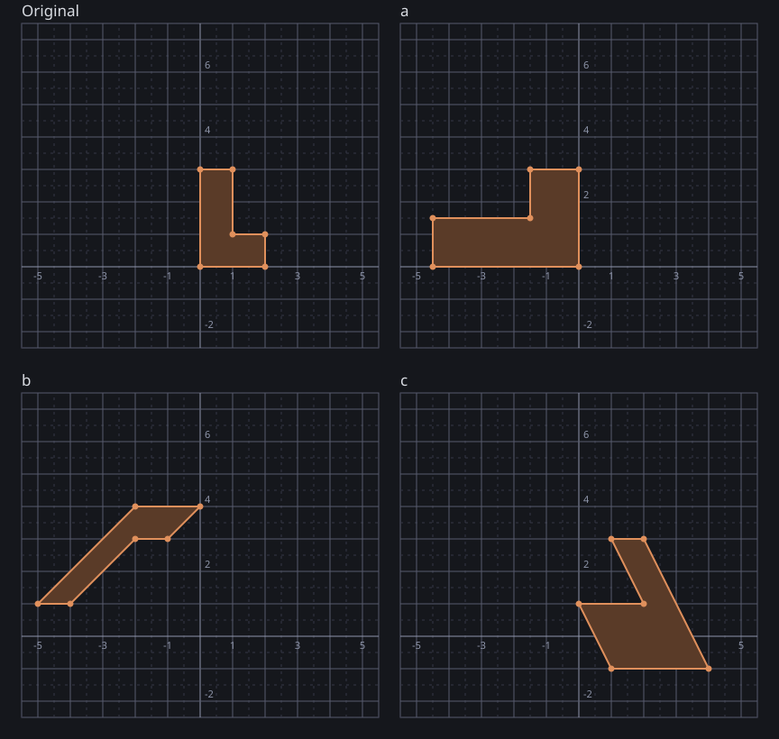

\begin{goals}

- Affine Transformationen eines Polygons in homogenen Koordinaten als $3 \times 3$-Matrix angeben.
- Aus der Abbildung eines Polygons die Grundtransformationen ablesen.
- Transformationen zu einer Gesamttransformation verketten und die Reihenfolge begründen.
- Eine Drehung um einen beliebigen Punkt aus Translation, Drehung und Rücktranslation zusammensetzen.
- An einer Matrix erkennen, was sie mit Fläche und Orientierung macht.

\end{goals}

\begin{prerequisites}
Kapitel 4 der Vorlesung: affine Abbildungen, homogene Koordinaten, die Transformationstypen und die Transformationskomposition.

Weiterführend: [3Blue1Brown, „Essence of linear algebra"](https://www.youtube.com/playlist?list=PLZHQObOWTQDPD3MizzM2xVFitgF8hE_ab) zu linearen Abbildungen und Matrizen.
\end{prerequisites}

## Punkte und homogene Koordinaten

Eine affine Abbildung besteht aus einer linearen Abbildung und einer anschließenden Verschiebung, also $f(\vect{p}) = A \vect{p} + \vect{b}$. Die lineare Abbildung $A$ dreht, spiegelt, skaliert oder schert, die Verschiebung $\vect{b}$ verschiebt. Als Matrixprodukt allein lässt sich das nicht schreiben, denn eine lineare Abbildung bildet den Nullvektor immer auf den Nullvektor ab.

In homogenen Koordinaten bekommt ein Punkt der Ebene eine dritte Koordinate $w$, für Punkte $w = 1$. Damit passen lineare Abbildung und Verschiebung in eine einzige Matrix:

$$
T \vect{p} =
\begin{pmatrix}
a_{00} & a_{01} & b_x \\
a_{10} & a_{11} & b_y \\
0 & 0 & 1
\end{pmatrix}
\begin{pmatrix} x \\ y \\ 1 \end{pmatrix}
=
\begin{pmatrix}
a_{00} x + a_{01} y + b_x \\
a_{10} x + a_{11} y + b_y \\
1
\end{pmatrix}
$$

Die letzte Zeile sorgt dafür, dass das Ergebnis wieder $w = 1$ hat. Werden mehrere Transformationen nacheinander ausgeführt, ist das Ergebnis wieder eine Matrix, nämlich das Produkt der einzelnen Matrizen.

Die Koordinaten eines Punktes sind dabei nicht eindeutig: $(x, y, 1)$ und $(2x, 2y, 2)$ beschreiben denselben Punkt, denn geteilt durch $w$ ergeben beide $(x, y)$. Punkte mit $w = 0$ liegen im Unendlichen, und $(0, 0, 0)$ ist nicht definiert.

\begin{webgl}[Unterschied zur Vorlesung]
Die Vorlesung schreibt die Transformationen für den dreidimensionalen Raum, also als $4 \times 4$-Matrizen. Diese Seite arbeitet in der Ebene; dasselbe Schema ergibt dort $3 \times 3$-Matrizen mit der letzten Zeile $(0, 0, 1)$. Die Achsen liegen wie in den Abbildungen der Vorlesung: $x$ nach rechts, $y$ nach oben.
\end{webgl}

## Die Grundtransformationen

Eine **Translation** verschiebt um $\vect{d} = (d_x, d_y)^\top$, eine **Skalierung** streckt oder staucht mit den Faktoren $s_x$ und $s_y$:

$$
T_{\vect{d}} =
\begin{pmatrix} 1 & 0 & d_x \\ 0 & 1 & d_y \\ 0 & 0 & 1 \end{pmatrix},
\qquad
S_{\vect{s}} =
\begin{pmatrix} s_x & 0 & 0 \\ 0 & s_y & 0 \\ 0 & 0 & 1 \end{pmatrix}
$$

Eine **Rotation** dreht um den Ursprung um den Winkel $\theta$. Eine **Spiegelung** kehrt eine Koordinate um und ist nach dieser Koordinate benannt: $M_x$ kehrt die $x$-Koordinate um und spiegelt damit an der $y$-Achse, $M_y$ kehrt die $y$-Koordinate um und spiegelt an der $x$-Achse.

$$
\begin{aligned}
R(\theta) &= \begin{pmatrix} \cos\theta & -\sin\theta & 0 \\ \sin\theta & \cos\theta & 0 \\ 0 & 0 & 1 \end{pmatrix} \\[4pt]
M_x &= \begin{pmatrix} -1 & 0 & 0 \\ 0 & 1 & 0 \\ 0 & 0 & 1 \end{pmatrix} \\[4pt]
M_y &= \begin{pmatrix} 1 & 0 & 0 \\ 0 & -1 & 0 \\ 0 & 0 & 1 \end{pmatrix}
\end{aligned}
$$

Eine **Scherung** verschiebt Punkte proportional zu einer Koordinate entlang einer anderen Achse. Der erste Index bezeichnet die Koordinate, die geändert wird, der zweite die Koordinate, die das steuert:

$$
H =
\begin{pmatrix} 1 & k_{xy} & 0 \\ k_{yx} & 1 & 0 \\ 0 & 0 & 1 \end{pmatrix}
$$

An $A$, dem linken oberen Teil der Matrix, lässt sich ablesen, um welchen Typ es sich handelt. Ist $A$ orthogonal, bleiben Längen und Winkel erhalten; mit $\det A = 1$ ist die Abbildung eine Rotation, mit $\det A = -1$ eine Spiegelung. Allgemein gibt $|\det A|$ an, wie sich die Fläche ändert, und das Vorzeichen, ob die Orientierung erhalten bleibt, also der Umlaufsinn der Eckpunkte (vertices).

In der Demo wird das Polygon vor der Transformation als Umriss und danach gefüllt gezeichnet. Die Pfeile im Ursprung sind die beiden Einheitsvektoren und ihre Bilder.

\demo{transformation}

\begin{task}[Grundtransformationen]
Probiere die fünf Transformationen in der Demo aus.

1. Stelle bei der Skalierung $s_x = -1$ und $s_y = 1$ ein. Welcher Grundtransformation entspricht das, und was sagt $\det A$ dazu?
2. Stelle eine Rotation um $90°$ ein. Wohin wird der Punkt $(1, 0)$ abgebildet, und in welcher Spalte der Matrix steht das?
3. Stelle eine Scherung mit $k_{xy} = 0.5$ ein. Wohin wandert der Eckpunkt $(1, 3)$? Sage es voraus und prüfe es danach in der Demo.

\end{task}

\begin{task}[Zurück zum Original]
Zu jeder Transformation gibt es eine, die sie rückgängig macht. Gib für eine Translation um $\vect{d}$, eine Skalierung um $\vect{s}$ und eine Rotation um $\theta$ jeweils die Parameter der Umkehrung an. Warum ist die Umkehrung einer Rotation gerade ihre transponierte Matrix?
\end{task}

\begin{task}[Herleitung der Rotationsmatrix (optional)]
Ein Punkt $\vect{p} = (x, y)^\top$ hat den Abstand $r = \sqrt{x^2 + y^2}$ vom Ursprung und schließt mit der $x$-Achse den Winkel $\theta = \operatorname{atan2}(y, x)$ ein. Das Paar $(r, \theta)$ sind die Polarkoordinaten des Punktes.

Zeige damit, dass der um $\phi$ gedrehte Punkt $\vect{p}'$ gerade $R(\phi)\, \vect{p}$ ist. Die trigonometrischen Rechenregeln, etwa die Additionstheoreme, darfst du dabei als gegeben annehmen.
\end{task}

## Verkettung

Werden die Transformationen $T_1 \to T_2 \to \ldots \to T_m$ nacheinander auf einen Punkt angewendet, ist das Ergebnis

$$
T_m \cdot (T_{m-1} \cdot \ldots \cdot (T_1 \vect{p})) = (T_m \cdot T_{m-1} \cdot \ldots \cdot T_1)\, \vect{p} = T_{\text{gesamt}}\, \vect{p}.
$$

Die zuerst ausgeführte Transformation steht also ganz rechts, direkt beim Punkt, und ein Produkt wird von rechts nach links gelesen. Ist $T_{\text{gesamt}}$ einmal berechnet, genügt eine Multiplikation pro Punkt, egal aus wie vielen Schritten die Transformation besteht.

Die Reihenfolge ist dabei entscheidend: Die Matrizenmultiplikation ist im Allgemeinen nicht kommutativ, also $T_A T_B \ne T_B T_A$. Nur in Sonderfällen lassen sich zwei Transformationen vertauschen, etwa zwei Translationen oder zwei Rotationen um denselben Punkt.

Die Demo verkettet eine Rotation $R$ und eine Translation $T$. „Zwischenschritt" zeigt das Polygon nach der ersten der beiden Transformationen. Es ist in der Farbe dieser Transformation schraffiert: blau nach der Rotation, grün nach der Translation.

\demo{composition}

\begin{task}[Reihenfolge]
Stelle $\theta = 90°$, $d_x = 3$ und $d_y = 0$ ein und schalte den Zwischenschritt an.

1. Wo liegt das Polygon am Ende, wenn erst gedreht und dann verschoben wird, und wo bei der anderen Reihenfolge?
2. Vergleiche die letzten Spalten der beiden Gesamttransformationen. In einer steht die eingestellte Verschiebung $(3, 0)$. Welcher Vektor steht in der anderen, und wie kommt er zustande?
3. Welche Verschiebung musst du bei „erst verschieben, dann drehen" einstellen, damit das Polygon dort landet, wo es bei der anderen Reihenfolge mit $\vect{d} = (3, 0)$ liegt?

\end{task}

## Drehung um einen Punkt

Die Rotationsmatrix dreht um den Ursprung. Soll ein Objekt um einen anderen Punkt $\vect{c}$ gedreht werden, wird es zuerst so verschoben, dass $\vect{c}$ im Ursprung liegt, dann gedreht und anschließend zurückgeschoben:

$$
T_{\text{gesamt}} = T_{\vect{c}} \cdot R(\theta) \cdot T_{-\vect{c}}
$$

Dasselbe Muster passt immer, wenn eine Transformation an einer bestimmten Stelle wirken soll: hinbringen, anwenden, zurückbringen.

\begin{task}[Drehung um einen Punkt]
Setze in der Demo $d_x = d_y = 0$, damit nur die Drehung wirkt, wähle als Drehzentrum „Punkt c" und ziehe $\vect{c}$ auf $(2, 1)$. Stelle $\theta = 90°$ ein.

Berechne $T_{\vect{c}} \cdot R(90°) \cdot T_{-\vect{c}}$ von Hand und vergleiche das Ergebnis mit der Gesamttransformation in der Demo. Was steht in der letzten Spalte, obwohl gar keine Translation gewünscht war?
\end{task}

## Eine Matrix ausprobieren

Die nächste Demo wendet eine Matrix an, die direkt eingetragen wird. Alle neun Einträge lassen sich setzen, und das Ergebnis wird durch $w$ geteilt. Mit der letzten Zeile $(0, 0, 1)$ bleibt $w = 1$, und die Abbildung ist affin.

\demo{matrix}

\begin{task}[Matrix lesen]
Arbeite in der Demo „Matrix lesen".

1. Sage zuerst voraus, was die Matrix $\begin{pmatrix} 0 & -1 & 2 \\ 1 & 0 & 1 \\ 0 & 0 & 1 \end{pmatrix}$ mit dem Polygon macht und welchen Wert $\det A$ hat. Trage sie danach ein und prüfe deine Vorhersage.
2. Trage eine Matrix ein, die das Polygon an der $y$-Achse spiegelt und es danach um $(0, 2)$ verschiebt.

\end{task}

## Transformationen im Programm

Im Programm werden die Matrizen genauso aufgebaut und verkettet, wie sie hier stehen. Die Verkettung ist eine gewöhnliche Matrizenmultiplikation:

```ts
function multiply(a: number[], b: number[]): number[] {
    const product = [0, 0, 0, 0, 0, 0, 0, 0, 0];
    for (let row = 0; row < 3; row++) {
        for (let column = 0; column < 3; column++) {
            for (let k = 0; k < 3; k++) {
                product[3 * row + column] += a[3 * row + k] * b[3 * k + column];
            }
        }
    }
    return product;
}
```

Das Produkt wird einmal pro Zeichenvorgang auf der CPU berechnet und als `uniform` an den Vertex-Shader übergeben. Dort wird jeder Eckpunkt in homogene Koordinaten ergänzt, mit dieser einen Matrix multipliziert und anschließend durch $w$ geteilt:

```glsl
vec3 transformed = transform * vec3(position, 1.0);
vec2 point = transformed.xy / transformed.z;
```

Alle Demos dieser Seite zeichnen so: Das Polygon liegt einmal im Speicher, und nur die Matrix ändert sich.

\begin{webgl}
GLSL speichert eine Matrix spaltenweise, die Vorlesung schreibt sie zeilenweise. Beim Hochladen mit `uniformMatrix3fv` schaltet der zweite Parameter das Transponieren ein, sodass die Zeilen im Code genauso stehen wie auf dem Papier.
\end{webgl}

## Eigene Umsetzung

\begin{task}[Grundtransformationen und Gesamttransformation]
Die Abbildung zeigt ein Polygon mit den Eckpunkten $(0,0)$, $(2,0)$, $(2,1)$, $(1,1)$, $(1,3)$ und $(0,3)$ und drei Versionen davon, die durch affine Transformationen daraus hervorgehen.



Gib für jede der drei Versionen die Grundtransformationen mit ihren Matrizen in homogenen Koordinaten an und bestimme daraus die Gesamttransformation. Es gibt mehr als eine mögliche Zerlegung; entscheidend ist, dass deine Grundtransformationen in deiner Reihenfolge die Gesamttransformation ergeben.

Schreibe deine Lösung in \vscode{loesung.md}[loesung.md] oder in das Textfeld unter dieser Aufgabe. Die Datei ist Markdown, Formeln kannst du in LaTeX schreiben. Deine Gesamttransformationen kannst du in der Demo „Matrix lesen" prüfen: Sie zeigt dasselbe Polygon auf demselben Gitter wie die Abbildung.

1. Welche deiner drei Gesamttransformationen erhält die Fläche des Polygons, und was sagt $\det A$ jeweils dazu?
2. In genau einer der drei Versionen lassen sich zwei deiner Grundtransformationen vertauschen, ohne dass sich das Ergebnis ändert. In welcher, und warum?

\end{task}

\textfield{loesung.md}

\begin{summary}
Beschreibe in eigenen Worten, was du auf dieser Seite gelernt hast und wie du vorgegangen bist. Save speichert deinen Text in \vscode{summary.md}[summary.md].

\textfield{summary.md}
\end{summary}

\begin{quiz}
Bei jeder Frage ist mindestens eine Antwort richtig, aber auch mehrere Antworten können richtig sein.

\begin{question}
Welche der Matrizen beschreibt eine Rotation?
- [ ] $\begin{pmatrix} -1 & 0 & 0 \\ 0 & 1 & 0 \\ 0 & 0 & 1 \end{pmatrix}$
- [x] $\begin{pmatrix} 0 & -1 & 0 \\ 1 & 0 & 0 \\ 0 & 0 & 1 \end{pmatrix}$
- [ ] $\begin{pmatrix} 2 & 0 & 0 \\ 0 & 2 & 0 \\ 0 & 0 & 1 \end{pmatrix}$
- [ ] $\begin{pmatrix} 1 & 0.5 & 0 \\ 0 & 1 & 0 \\ 0 & 0 & 1 \end{pmatrix}$
\end{question}

\begin{question}
Was gilt für homogene Koordinaten in der Ebene?
- [x] $(x, y, 1)$ und $(2x, 2y, 2)$ beschreiben denselben Punkt.
- [ ] Der Punkt $(0, 0, 0)$ ist der Ursprung.
- [x] Die letzte Zeile einer affinen Transformation ist $(0, 0, 1)$.
- [ ] Ohne die dritte Koordinate ließe sich eine Rotation nicht als Matrix schreiben.
\end{question}

\begin{question}
Ein Polygon wird erst mit $\vect{s} = (2, 1)$ skaliert, dann um $90°$ gedreht und dann um $(1, 0)$ verschoben. Welches Produkt beschreibt das?
- [ ] $S \cdot R \cdot T$
- [ ] $T \cdot S \cdot R$
- [ ] $R \cdot S \cdot T$
- [x] $T \cdot R \cdot S$
\end{question}

\begin{question}
Wohin bildet die Scherung mit $k_{xy} = 2$ und $k_{yx} = 0$ den Punkt $(1, 3)$ ab?
- [x] $(7, 3)$
- [ ] $(1, 7)$
- [ ] $(3, 1)$
- [ ] $(2, 6)$
\end{question}

\begin{question}
Eine affine Transformation hat $\det A = -2$. Was folgt daraus?
- [ ] Das Polygon wird um den Faktor 2 verschoben.
- [x] Die Fläche des Polygons verdoppelt sich.
- [ ] Die Transformation ist eine Rotation.
- [x] Die Orientierung des Polygons kehrt sich um.
\end{question}

\begin{question}
Ein Objekt soll um den Punkt $\vect{c}$ gedreht werden. Welche Verkettung leistet das?
- [ ] $R(\theta) \cdot T_{\vect{c}}$
- [ ] $T_{-\vect{c}} \cdot R(\theta) \cdot T_{\vect{c}}$
- [x] $T_{\vect{c}} \cdot R(\theta) \cdot T_{-\vect{c}}$
- [ ] $T_{\vect{c}} \cdot R(\theta)$
\end{question}
\end{quiz}
