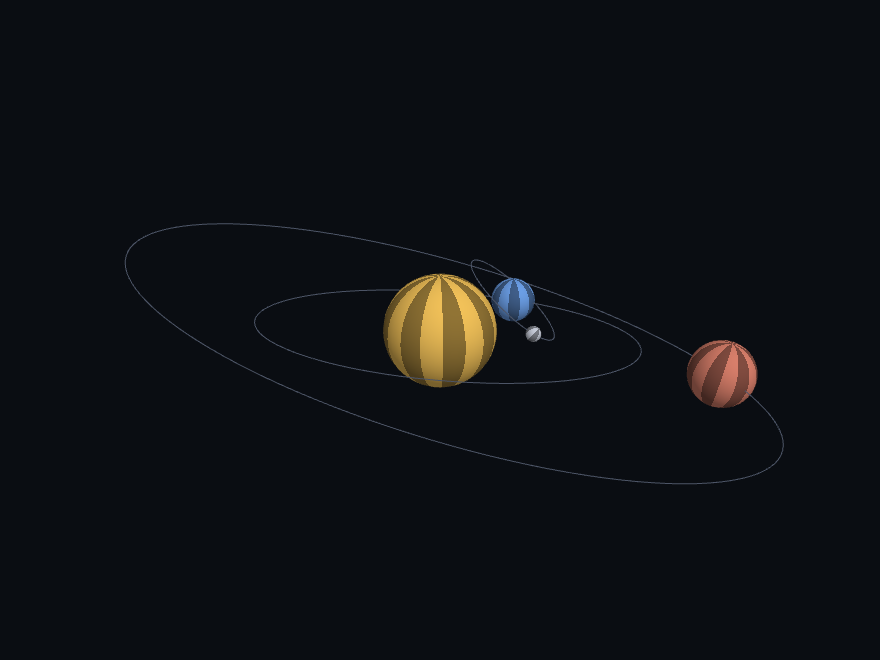

\begin{goals}

- Szenengraph aus geschachtelten lokalen Koordinatensystemen
- Gesamttransformation als Produkt bis zur Wurzel
- Transformationen als `uniform` im Vertex-Shader

\end{goals}

\begin{prerequisites}
Kapitel 4 der Vorlesung: Transformationskomposition, hierarchische Koordinatensysteme und Model-View Transformationen. Die Grundtransformationen und die Reihenfolge im Matrizenprodukt stehen auf der Seite „Matrixtransformationen".
\end{prerequisites}

## Geschachtelte Koordinatensysteme

In einem Szenengraph kann jeder Knoten eine Transformation angeben, die auf ihn und alle seine Kindknoten wirkt. Wird bei der Traversierung eine Objektgeometrie erreicht, werden die Transformationen vom Wurzelknoten bis zu diesem Knoten als Gesamttransformation angewendet. Die lokalen Transformationen wirken also stets nur abwärts im Szenengraphen. Beim Traversieren werden sie über einen Transformationsstack gesichert; oben auf dem Stack steht die Gesamttransformation des Knotens, bei dem die Traversierung gerade ist. Die Vorlesung zeigt das an einem Dreirad, dessen Szenengraphstruktur dem geometrischen Aufbau folgt: Lenkstange und Vorderrad hängen unter dem Knoten der Lenkung und drehen sich mit ihr.

Das Beispiel hier ist ein Karussell aus drei Knoten. Die Plattform dreht sich um ihre Achse, an ihr sitzt ein Arm der Länge $r$, und am Ende des Arms hängt eine Gondel, die sich noch einmal selbst dreht:

| Knoten | Lokale Transformation | Transformationsstack |
|---|---|---|
| Plattform | $T_0 = R_z(\varphi_1)$ | $[T_0]$ |
| Arm | $T_1 = T_{(r, 0, 0)}$ | $[T_0 \mid T_0 T_1]$ |
| Gondel | $T_2 = R_z(\varphi_2)$ | $[T_0 \mid T_0 T_1 \mid T_0 T_1 T_2]$ |

Jeder Knoten kennt also nur seine eigene Transformation; die Gesamttransformation entsteht erst aus dem Weg bis zur Wurzel. Die Geometrie der Gondel wird mit $T_0 T_1 T_2$ gezeichnet, die des Arms mit $T_0 T_1$.

\begin{note}[Über die Vorlesung hinaus: Kamera, Projektion und Tiefentest]
Eine räumliche Szene braucht neben der Model-Transformation noch zwei weitere Transformationen. Die View-Transformation beschreibt, von wo aus die Szene betrachtet wird, und die Projektion bildet den sichtbaren Bereich auf das Canvas ab. Beide sind wieder $4 \times 4$-Matrizen und lassen sich mit der Gesamttransformation eines Körpers zu einer einzigen Matrix verketten. Das Paket `gl-matrix`, das jede Übung schon mitbringt, baut sie mit `mat4.lookAt(view, eye, center, up)` und `mat4.perspective(projection, fovy, aspect, near, far)`. Kapitel 5 behandelt die geometrischen Projektionen; bis dahin genügen diese beiden Matrizen.

Außerdem muss pro Pixel entschieden werden, welche Fläche vorn liegt. Das übernimmt der Tiefentest, eingeschaltet mit `gl.enable(gl.DEPTH_TEST)`. Der Tiefenpuffer wird zusammen mit dem Farbpuffer gelöscht. Ohne ihn verdeckt einfach die zuletzt gezeichnete Fläche alle anderen.

Die Szenen dieses Übungsblattes liegen in einem rechtshändigen Koordinatensystem, in dem $z$ nach oben zeigt.
\end{note}

## Von der Hierarchie zum Shader

Früher verwaltete OpenGL die Matrix-Hierarchie implizit über einen Model-View-Transformationsstack, heutige Anwendungen verwalten sie selbst: In einem Pretraversal des Szenengraphen wird die Gesamttransformation für jede Objektgeometrie einmal berechnet und gespeichert, und beim Zeichnen bekommt der Shader sie als `uniform`-Variable. Jeder Körper hat dadurch seine eigene finale Transformation. Eine `uniform`-Variable hat für alle Eckpunkte (vertices) eines Zeichenvorgangs denselben Wert, und genau das wird hier gebraucht: Die Matrix gilt für den ganzen Körper.

Der Vertex-Shader der Demo bekommt in `u_stack` die lokalen Transformationen vom Wurzelknoten bis zum Knoten des Körpers und in `u_depth`, wie viele Einträge davon zu diesem Knoten gehören. Kamera und Projektion stehen zusammengefasst in `u_viewProjection`:

```glsl
uniform mat4 u_stack[3];
uniform int u_depth;
uniform mat4 u_viewProjection;
```

\begin{note}[Stack statt Produkt]
Im Pretraversal der Vorlesung wird das Produkt auf der CPU gebildet und als eine fertige Matrix übergeben. Die Demo übergibt stattdessen den Stack selbst, damit die Verkettung im Shader steht und sich dort nachvollziehen lässt. In einer Anwendung lohnt sich das nicht: Das Produkt ist für alle Eckpunkte eines Körpers gleich und wird deshalb einmal pro Körper berechnet, nicht einmal pro Eckpunkt.
\end{note}

\demo{hierarchy}[hierarchy.vert]

\begin{task}[Die Gesamttransformation im Shader]
Die Demo zeichnet die drei Körper des Karussells. `model` steht im Shader noch auf der Einheitsmatrix, sodass alle drei im Ursprung liegen.

Ergänze `hierarchy.vert` im Editor so, dass `model` die Gesamttransformation des Knotens wird: das Produkt der ersten `u_depth` Einträge von `u_stack`, in der Reihenfolge, in der sie dort stehen.
\end{task}

## Was ein Knoten mitzieht

Über „Knoten" zeigt die Demo die lokale Transformation und die Gesamttransformation eines der drei Knoten an. Damit lässt sich verfolgen, wie sich eine Änderung an einem Knoten im Produkt niederschlägt. „Szenengraph" zeigt den Baum der drei Knoten und markiert den gewählten Knoten und seinen Elternknoten.

\begin{task}[Mitbewegen und Reihenfolge]

1. Ändere „Plattform: Drehung" und danach „Gondel: Drehung". Welche Körper bewegen oder drehen sich jeweils mit, und welche nicht?
2. Stelle „Verkettung im Arm" auf „lokal · Eltern", sodass im Arm statt $T_0 T_1$ das Produkt $T_1 T_0$ gebildet wird. Was macht die Gondel danach, wenn die Plattform gedreht wird, und wie kommt das zustande?
3. Stelle die Verkettung wieder auf „Eltern · lokal" und sieh dir die Gesamttransformation der Gondel für „Plattform: Drehung" $= 0°$ und für $90°$ an, bei festem Arm und fester Gondel. Welche Einträge ändern sich dabei, und wie kommt die Drehung der Plattform in das Produkt $T_0 T_1 T_2$?

\end{task}

## Eigene Umsetzung

\begin{task}[Eigenes Sonnensystem]
Schreibe ein Programm, das ein Sonnensystem aus mehreren Körpern zeigt, die über eine Hierarchie lokaler Transformationen angeordnet sind. Mindestens ein Körper soll einen Körper umkreisen, der selbst einen anderen umkreist, also Sonne, Planet und Mond. Rufe deinen Code aus \vscode{src/solution/index.ts}[start] auf; das Ergebnis erscheint in der Demo unter dieser Aufgabe.

Jeder Körper dreht sich außerdem um seine eigene Achse, die Bahnen sind Ellipsen, mindestens eine Bahn ist gegen die anderen geneigt, und die Körper sind so eingefärbt, dass ihre Eigendrehung zu sehen ist. Die Szene läuft über eine Zeit, die sich einstellen und anhalten lässt.

Dafür brauchst du aus Kapitel 4 die Transformationskomposition, die hierarchischen Koordinatensysteme und die Model-Transformation als `uniform`.

1. Was passiert mit dem Mond, wenn du die Umlaufzeit des Planeten änderst, und warum?
2. Wende bei einem Körper die Verschiebung auf seine Bahn vor seiner Eigendrehung an statt danach. Wie bewegt er sich dann?
3. Ändere die Eigendrehung der Sonne. Welche anderen Körper bewegen sich danach anders, welche nicht?

\begin{solution}

\end{solution}
\end{task}

\demo{solution}

\begin{task}[Mehr Szene (optional)]
Baue die Szene weiter aus. Ideen: mehr Planeten und Monde, eine geneigte Rotationsachse, ein Ring um einen Planeten, sichtbare Bahnkurven, oder ein Körper, dessen Geometrie du aus einer eigenen Datei lädst.
\end{task}

\begin{summary}
Beschreibe in eigenen Worten, was du auf dieser Seite gelernt hast und wie du vorgegangen bist. Save speichert deinen Text in \vscode{summary.md}[summary.md].

\textfield{summary.md}
\end{summary}

\begin{quiz}
Bei jeder Frage ist mindestens eine Antwort richtig, aber auch mehrere Antworten können richtig sein.

\begin{question}
Auf welche Knoten wirkt die Transformation eines Knotens im Szenengraphen?
- [ ] Auf den Elternknoten.
- [x] Auf den Knoten selbst.
- [x] Auf alle seine Kindknoten.
- [ ] Auf alle Knoten der Szene.
\end{question}

\begin{question}
Eine Geometrie $g$ hängt unter drei geschachtelten Knoten mit den lokalen Transformationen $T_0$ (Wurzel), $T_1$ und $T_2$. Wie wird sie gezeichnet?
- [ ] $T_1 T_2\, g$
- [ ] $T_2 T_1 T_0\, g$
- [x] $T_0 T_1 T_2\, g$
- [ ] $T_0\, g$
\end{question}

\begin{question}
Was steht beim Traversieren oben auf dem Transformationsstack, wenn ein Knoten erreicht wird?
- [ ] Nur die lokale Transformation dieses Knotens.
- [ ] Die Transformation des zuletzt gezeichneten Körpers.
- [x] Die Gesamttransformation dieses Knotens.
- [ ] Die Transformation des Wurzelknotens.
\end{question}

\begin{question}
Ein Knoten bekommt zusätzlich eine isotrope Skalierung $S_{(2,2,2)}$. Was folgt daraus?
- [x] Die Geometrien aller Kindknoten werden mit skaliert.
- [x] Die Abstände der Kindknoten vom Ursprung des Knotens verdoppeln sich.
- [ ] Die Skalierung wirkt nur auf die Geometrie des Knotens selbst.
- [ ] Die Kindknoten behalten ihre Position und ihre Größe.
\end{question}

\begin{question}
Warum wird die Gesamttransformation eines Körpers als `uniform` übergeben und nicht als Attribut pro Eckpunkt?
- [ ] Die GPU kann keine Matrizen multiplizieren.
- [x] Sie ist für alle Eckpunkte eines Körpers dieselbe.
- [ ] Attribute wären dafür zu langsam.
- [ ] Die Matrix ist für jeden Eckpunkt eine andere.
\end{question}

\begin{question}
Was leistet der Tiefentest?
- [ ] Er sortiert die Körper vor dem Zeichnen nach ihrem Abstand.
- [x] Er entscheidet pro Pixel, welche Fläche vorn liegt.
- [ ] Er ist in WebGL immer eingeschaltet.
- [ ] Er ersetzt das Face Culling.
\end{question}
\end{quiz}
