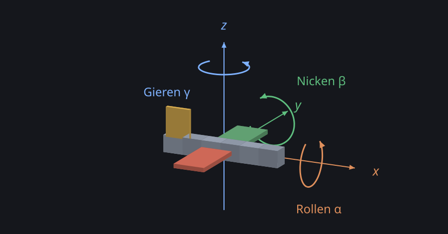
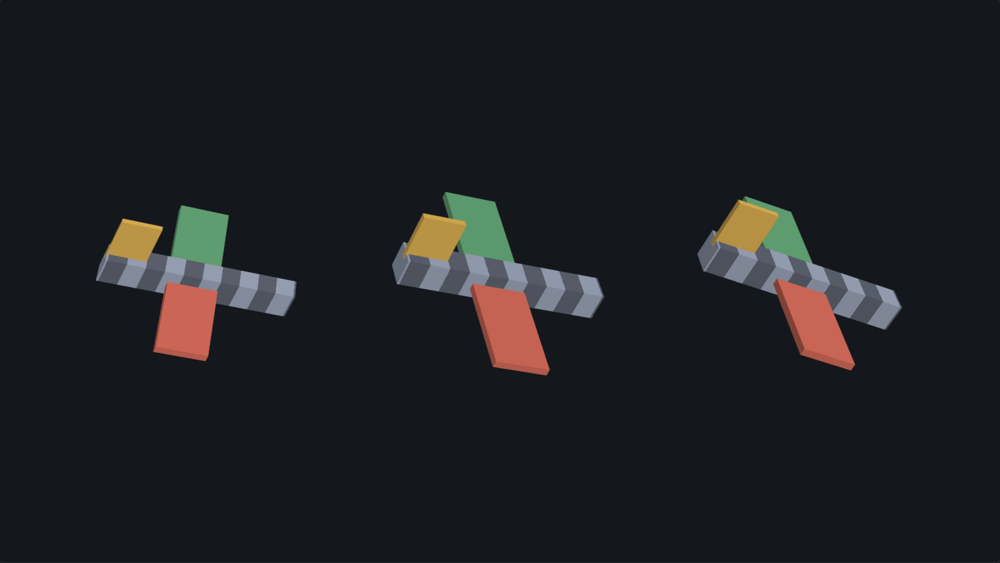

\begin{goals}

- Darstellungen einer Rotation: Matrix, Eulerwinkel, Quaternion
- Gimbal Lock
- Interpolation von Orientierungen und Slerp

\end{goals}

\begin{prerequisites}
Kapitel 4 der Vorlesung: Rotationen und Orthonormalbasen, Eulersche Winkel, Quaternionen und die sphärische lineare Interpolation. Kamera, Projektion und Tiefentest stehen auf der Seite „Szenenhierarchie".
\end{prerequisites}

## Orientierung mit Eulerwinkeln

Die Eulerwinkel beschreiben eine Rotation im Raum als Abfolge von drei Einzelrotationen um die Hauptachsen. Die Vorlesung bezeichnet sie mit $\alpha$ für die Rotation um die $x$-Achse (roll), $\beta$ um die $y$-Achse (pitch, nick) und $\gamma$ um die $z$-Achse (yaw, gier). Die Achsen können weltbezogen sein, dann heißt die Rotation extrinsisch, oder lokal objektbezogen, dann heißt sie intrinsisch.

Die Reihenfolge der drei Einzelrotationen ist entscheidend und wird mit angegeben, etwa Z-Y-X für

$$
R_{ZYX}(\gamma, \beta, \alpha) = R_z(\gamma)\, R_y(\beta)\, R_x(\alpha),
$$

und entsprechend X-Y-Z für $R_{XYZ}(\alpha, \beta, \gamma) = R_x(\alpha)\, R_y(\beta)\, R_z(\gamma)$. Wie bei jeder Verkettung steht die zuerst ausgeführte Rotation rechts: Bei Z-Y-X wird also zuerst um $x$ gedreht. Die Achsen der drei Einzelrotationen sind dabei die festen Achsen der Welt, die Rotation ist also extrinsisch.

Ausmultipliziert ist das

$$
R_{ZYX}(\gamma, \beta, \alpha) =
\begin{pmatrix}
\cos\gamma \cos\beta & \cos\gamma \sin\beta \sin\alpha - \sin\gamma \cos\alpha & \cos\gamma \sin\beta \cos\alpha + \sin\gamma \sin\alpha \\
\sin\gamma \cos\beta & \sin\gamma \sin\beta \sin\alpha + \cos\gamma \cos\alpha & \sin\gamma \sin\beta \cos\alpha - \cos\gamma \sin\alpha \\
-\sin\beta & \cos\beta \sin\alpha & \cos\beta \cos\alpha
\end{pmatrix}.
$$

Drei Zahlen genügen also für eine Orientierung, und jede einzelne hat eine anschauliche Bedeutung. Der Preis dafür ist der Gimbal Lock: Führt eine der Zwischenrotationen dazu, dass zwei der drei Rotationsachsen parallel werden, rotieren zwei der Winkel in derselben Ebene, und von den drei Freiheitsgraden bleiben nur zwei übrig.

\begin{note}[Über die Vorlesung hinaus: Kamera, Projektion und Tiefentest]
Die Demos dieser Seite zeichnen räumlich und brauchen dafür neben der Model-Transformation noch eine View- und eine Projektionsmatrix sowie den Tiefentest. Beides ist auf der Seite „Szenenhierarchie" beschrieben; die Szenen liegen wieder in einem rechtshändigen Koordinatensystem, in dem $z$ nach oben zeigt.
\end{note}

Die Demo zeigt ein Flugzeug, dessen Nase entlang der $x$-Achse zeigt und dessen Tragflächen entlang der $y$-Achse liegen.

\demo{euler}

\begin{task}[Reihenfolge der Eulerwinkel]

1. Stelle $\alpha = 90°$ und $\gamma = 90°$ ein und schalte die Reihenfolge zwischen Z-Y-X und X-Y-Z um. Ist die Orientierung in beiden Fällen dieselbe? Vergleiche auch die angezeigten Rotationsmatrizen.
2. Stelle $\beta = 45°$ und danach $\gamma = 90°$ ein. Dreht sich das Flugzeug dabei um seine eigene Hochachse oder um die $z$-Achse der Welt?

\end{task}

\begin{task}[Gimbal Lock]
Stelle die Reihenfolge Z-Y-X und $\beta = 90°$ ein und ändere danach nacheinander $\alpha$ und $\gamma$.

Was machen die beiden Regler mit dem Flugzeug, und welche beiden Einzelrotationen drehen es jetzt um dieselbe Achse? Welche Drehung des Flugzeugs lässt sich mit den drei Reglern nicht mehr einstellen?
\end{task}

## Quaternionen

Ein Quaternion ist die Erweiterung der komplexen Zahlen um drei imaginäre Einheiten, geschrieben als $q = (w, \vect{v})$ mit $w \in \R$ und $\vect{v} = (x, y, z)^\top \in \R^3$. Die Multiplikation zweier Quaternionen ist

$$
q_1 q_2 = (w_1, \vect{v}_1)(w_2, \vect{v}_2) = \left(w_1 w_2 - \vect{v}_1 \cdot \vect{v}_2,\; w_1 \vect{v}_2 + w_2 \vect{v}_1 + \vect{v}_1 \times \vect{v}_2\right),
$$

und sie ist nicht kommutativ. Dazu kommen die Konjugation $q^{*} = (w, -\vect{v})$, das Skalarprodukt $\langle q_1, q_2 \rangle = w_1 w_2 + \langle \vect{v}_1, \vect{v}_2 \rangle$, die Norm $\lVert q \rVert = \sqrt{\langle q, q \rangle}$ und die Inverse $q^{-1} = \frac{q^{*}}{\lVert q \rVert^2}$, die für eine Einheitsquaternion gerade $q^{-1} = q^{*}$ ist.

Eine Einheitsquaternion lässt sich als Rotation um die Achse $\vect{r}$ mit dem Winkel $\theta$ lesen:

$$
q = \left(\cos\frac{\theta}{2},\; \sin\frac{\theta}{2}\, \vect{r}\right)
$$

Ein Punkt $\vect{a}$ wird als reines Quaternion $p = (0, \vect{a})$ geschrieben und mit $p' = q\, p\, q^{-1}$ rotiert; der Imaginärteil von $p'$ ist der rotierte Punkt. Zwei Rotationen werden wie zwei Matrizen verkettet: Erst $q_1$, dann $q_2$ ergibt $q_2 q_1$. Das Produkt zweier Einheitsquaternionen ist wieder eine Einheitsquaternion, also wieder eine Rotation — anders als bei Matrizen, deren Orthogonalität über viele Produkte hinweg verloren geht.

Für das Zeichnen wird daraus wieder eine Matrix. Zu $q = (w, x, y, z)$ gehört die Rotationsmatrix

$$
M_q =
\begin{pmatrix}
1 - 2y^2 - 2z^2 & 2xy - 2wz & 2xz + 2wy \\
2xy + 2wz & 1 - 2x^2 - 2z^2 & 2yz - 2wx \\
2xz - 2wy & 2yz + 2wx & 1 - 2x^2 - 2y^2
\end{pmatrix}.
$$

Umgekehrt lässt sich aus einer orthogonalen Matrix $M$ wieder eine Einheitsquaternion gewinnen, aus der Summe ihrer Diagonalkomponenten und drei Differenzen:

$$
\begin{aligned}
w &= \frac{1}{2}\sqrt{1 + m_{00} + m_{11} + m_{22}} \\[4pt]
x &= \frac{m_{21} - m_{12}}{4w}, \qquad
y = \frac{m_{02} - m_{20}}{4w}, \qquad
z = \frac{m_{10} - m_{01}}{4w}
\end{aligned}
$$

Eine Orientierung lässt sich also in beiden Richtungen umrechnen. Vier Zahlen genügen für eine Rotation, eine Rotationsmatrix braucht neun oder sechzehn; dafür verarbeitet die Grafikpipeline Transformationen ausschließlich als Matrizen, sodass Quaternionen vor dem Zeichnen umgewandelt werden.

\begin{webgl}
`gl-matrix` speichert ein Quaternion als `[x, y, z, w]`, also mit dem Realteil hinten, während die Vorlesung $q = (w, \vect{v})$ schreibt. `quat.fromMat3` und `mat4.fromQuat` rechnen zwischen Matrix und Quaternion um. `webgl-operate` übernimmt diese Typen und Funktionen unverändert von `gl-matrix`, dort gilt also dasselbe.
\end{webgl}

\begin{task}[Ein Quaternion lesen]
Gib die Einheitsquaternion für eine Drehung um $90°$ um die $y$-Achse an und zeige, dass $\lVert q \rVert = 1$ gilt.

Zeige außerdem mit $p' = q\, p\, q^{-1}$, dass $q$ und $-q$ dieselbe Drehung beschreiben.
\end{task}

## Zwischen zwei Orientierungen

Ein Objekt hat die Orientierung $q_1$ und soll die Orientierung $q_2$ bekommen. Gesucht ist ein Weg dazwischen, auf dem es sich mit konstanter Drehgeschwindigkeit bewegt. Drei Wege liegen nahe:

- Die 16 Koeffizienten der beiden Rotationsmatrizen linear interpolieren.
- Die drei Eulerwinkel linear interpolieren und daraus die Matrix bauen.
- Die beiden Quaternionen sphärisch interpolieren.

Der erste Weg mischt die Koeffizienten zweier Rotationsmatrizen, der zweite interpoliert drei getrennte Winkel unabhängig voneinander. Auch eine lineare Interpolation der Quaternionen, $q_t = \operatorname{lerp}(q_1, q_2, t)$, geht fehl, denn im Allgemeinen ist $\lVert q_t \rVert \ne 1$, und $q_t$ ist damit keine Rotation.

Die Lösung ist die sphärische lineare Interpolation:

$$
\operatorname{Slerp}(q_1, q_2, t) = \frac{\sin((1-t)\alpha)}{\sin\alpha}\, q_1 + \frac{\sin(t\alpha)}{\sin\alpha}\, q_2, \qquad t \in [0, 1], \quad \cos\alpha = \langle q_1, q_2 \rangle
$$

Beide Eingaben sind Einheitsquaternionen. Slerp liefert $q_1$ für $t = 0$ und $q_2$ für $t = 1$, bleibt normiert und entspricht einem Bogen auf der Einheitskugel, also einer Interpolation mit konstanter Geschwindigkeit und ohne Beschleunigung. Ist $\langle q_1, q_2 \rangle < 0$, wird $q_2$ durch $-q_2$ ersetzt, damit der kürzere der beiden Bögen genommen wird. Für sehr kleine $\alpha$ wird $\sin\alpha \approx 0$; dort ist die Formel nicht mehr brauchbar, und die lineare Interpolation genügt.

\begin{note}[Notation]
Das Zeichen $\alpha$ steht auf dieser Seite an zwei Stellen für verschiedene Dinge, beide Male wie in der Vorlesung: oben für den Rollwinkel um die $x$-Achse, hier für den Winkel zwischen den beiden Quaternionen.
\end{note}

Die Demo zeigt für drei Paare von Orientierungen alle drei Wege nebeneinander: links die Matrixkoeffizienten, in der Mitte die Eulerwinkel, rechts Slerp. Die Körper laufen mit $t$ zusätzlich ein Stück nach vorn.

\demo{interpolation}

\begin{task}[Matrixkoeffizienten]
Wähle das Orientierungspaar A und ziehe $t$ langsam von 0 nach 1. Sieh dir dabei das linke Flugzeug und die angezeigte Determinante an.

Was passiert mit beiden um $t = 0.5$ herum? Was folgt daraus für die Längen und Winkel im Körper, und warum ist eine Mischung zweier Rotationsmatrizen im Allgemeinen keine Rotation?
\end{task}

\begin{task}[Eulerwinkel und Slerp]

1. Wähle das Paar B. An welcher Stelle des Weges unterscheiden sich das mittlere und das rechte Flugzeug am stärksten, und welches der beiden dreht sich auf dem ganzen Weg weiter?
2. Wähle das Paar C und ziehe $t$ in kleinen Schritten von 0 nach 1; mit „Tempo" kannst du den Weg auch ablaufen lassen. Wie ändert sich die Drehung pro Schritt bei den beiden Flugzeugen, und was ist an der Startorientierung besonders?

\end{task}

## Eigene Umsetzung

\begin{task}[Drei Wege zwischen zwei Orientierungen]
Schreibe ein Programm, das einen Körper von einer Start- in eine Zielorientierung bewegt, und zwar auf allen drei Wegen: über die Matrixkoeffizienten, über die Eulerwinkel und über Slerp. Die drei Ergebnisse sollen zum selben Zeitpunkt nebeneinander zu sehen sein, damit sie sich vergleichen lassen. Rufe deinen Code aus \vscode{src/solution/index.ts}[start] auf; das Ergebnis erscheint in der Demo unter dieser Aufgabe.

Start- und Zielorientierung werden als Eulerwinkel angegeben und lassen sich ändern, $t$ lässt sich einstellen und abspielen, und der Körper ist so eingefärbt, dass seine Orientierung zu erkennen ist. Den Körper der Demos dieser Seite darfst du übernehmen.

Die Interpolationen schreibst du selbst; für Vektoren, Matrizen und Quaternionen darfst du `gl-matrix` verwenden, das die Übung schon mitbringt.

Dafür brauchst du aus Kapitel 4 die Eulerwinkel in der Reihenfolge Z-Y-X, die Quaternionen als Rotationsdarstellung und die sphärische lineare Interpolation.

1. Suche ein Paar von Orientierungen, bei dem der Weg über die Eulerwinkel und der Weg über Slerp möglichst weit auseinanderlaufen. Woran liegt es bei deinem Paar?
2. Wie unterscheidet sich der Körper auf dem Weg über die Matrixkoeffizienten bei $t = 0.5$ von dem auf dem Weg über Slerp?
3. Wähle ein Paar mit $\langle q_1, q_2 \rangle < 0$ und lass die Regel für den kürzeren Bogen weg. Welchen Weg nimmt der Körper dann, und wie weit dreht er sich?

\begin{solution}

\end{solution}
\end{task}

\demo{solution}

\begin{task}[Mehr Wege (optional)]
Probiere weitere Varianten aus. Ideen: eine normierte lineare Interpolation der Quaternionen im Vergleich mit Slerp, eine andere Reihenfolge der Eulerwinkel, oder Achse und Winkel der Drehung, die aus deinem Ergebnis wieder abgelesen werden.
\end{task}

\begin{summary}
Beschreibe in eigenen Worten, was du auf dieser Seite gelernt hast und wie du vorgegangen bist. Save speichert deinen Text in \vscode{summary.md}[summary.md].

\textfield{summary.md}
\end{summary}

\begin{quiz}
Bei jeder Frage ist mindestens eine Antwort richtig, aber auch mehrere Antworten können richtig sein.

\begin{question}
Welche Aussagen über die Eulerwinkel $\alpha$, $\beta$ und $\gamma$ treffen zu?
- [ ] $\alpha$ ist der Gierwinkel um die $z$-Achse.
- [x] $\beta$ ist der Nickwinkel um die $y$-Achse.
- [x] $R_{ZYX}(\gamma, \beta, \alpha) = R_z(\gamma) R_y(\beta) R_x(\alpha)$.
- [ ] Die Reihenfolge der drei Einzelrotationen ist für das Ergebnis gleichgültig.
\end{question}

\begin{question}
Was geschieht beim Gimbal Lock?
- [x] Zwei der drei Rotationsachsen werden parallel.
- [ ] Die Rotationsmatrix ist nicht mehr invertierbar.
- [x] Von den drei Freiheitsgraden bleiben nur zwei übrig.
- [ ] Das Objekt lässt sich gar nicht mehr drehen.
\end{question}

\begin{question}
Welche Einheitsquaternion beschreibt die Drehung um den Winkel $\theta$ um die Achse $\vect{r}$?
- [ ] $(\theta, \vect{r})$
- [x] $\left(\cos\frac{\theta}{2}, \sin\frac{\theta}{2} \vect{r}\right)$
- [ ] $\left(\sin\frac{\theta}{2}, \cos\frac{\theta}{2} \vect{r}\right)$
- [ ] $(\cos\theta, \sin\theta\, \vect{r})$
\end{question}

\begin{question}
Was gilt für $q_t = \operatorname{lerp}(q_1, q_2, t)$ bei zwei Einheitsquaternionen $q_1$ und $q_2$?
- [ ] $q_t$ ist für jedes $t$ wieder eine Rotation.
- [x] Im Allgemeinen ist $\lVert q_t \rVert \ne 1$.
- [ ] $q_t$ ist dasselbe wie $\operatorname{Slerp}(q_1, q_2, t)$.
- [ ] $q_t$ ist nicht definiert.
\end{question}

\begin{question}
Welche Eigenschaften hat $\operatorname{Slerp}(q_1, q_2, t)$?
- [x] Für $t = 0$ ergibt sich $q_1$.
- [x] Die Drehgeschwindigkeit ist konstant.
- [ ] Der Weg führt immer über den längeren der beiden Bögen.
- [ ] Die beiden Eingaben müssen nicht normiert sein.
\end{question}

\begin{question}
Was sagt die Vorlesung zum Vergleich von Quaternion und Rotationsmatrix?
- [x] Eine Quaternion braucht 4 floats, eine Rotationsmatrix 9 oder 16.
- [x] Das Produkt zweier Einheitsquaternionen ist wieder eine Rotation.
- [ ] Quaternionen werden direkt an die GPU übergeben.
- [ ] Rotationsmatrizen lassen sich über viele Produkte hinweg ohne Korrektur verketten.
\end{question}

\begin{question}
Die 16 Koeffizienten zweier Rotationsmatrizen werden linear interpoliert. Was gilt für das Ergebnis?
- [x] Die Determinante ist im Allgemeinen nicht mehr 1.
- [x] Längen bleiben im Allgemeinen nicht erhalten.
- [ ] Das Ergebnis stimmt mit Slerp überein.
- [ ] Nur die Translation ist falsch.
\end{question}
\end{quiz}
