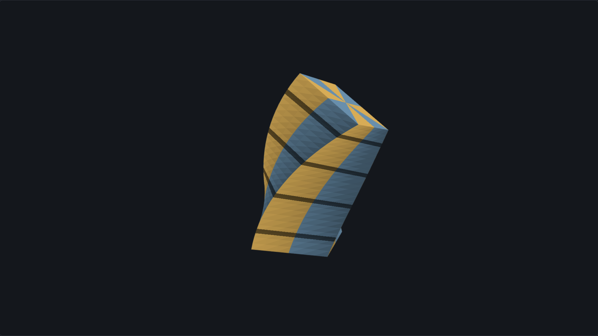

\begin{goals}

- Nichtlineare Transformationen und warum sie keine Matrix haben
- Axiale globale Deformationen: Amplitude $a$ und Funktion $s$
- Tessellierung und Genauigkeit einer Deformation

\end{goals}

\begin{prerequisites}
Kapitel 4 der Vorlesung: Nichtlineare Transformationen und globale Deformationen. Kamera, Projektion und Tiefentest stehen auf der Seite „Szenenhierarchie".
\end{prerequisites}

## Nichtlineare Transformationen

Eine lineare Transformation hat die Form $f(\vect{v}) = A\vect{v}$ mit $A \in \R^{4 \times 4}$. Die Transformationen der ersten beiden Seiten waren von dieser Form, und mehrere davon ließen sich zu einer einzigen Matrix verketten. Eine nichtlineare Transformation lässt sich nicht als Matrizenmultiplikation ausdrücken. Zwei Beispiele der Vorlesung sind $f(\vect{v}) = \lambda\, \mathrm{normalize}(\vect{v})$, das alle Punkte auf die Kugelsphäre mit Radius $\lambda$ abbildet, und $f(\vect{v}) = \vect{v} + \mathrm{noise}(\vect{v})$, das die Punkte mit einer Störfunktion verwackelt.

Nichtlineare Transformationen garantieren weder den Erhalt von Geraden noch den von Parallelität. Sie werden deshalb nicht durch Matrizen repräsentiert, sondern prozedural durch ein Shader-Programm: Der Vertex-Shader des Objekts berechnet die neue Position jedes Eckpunkts (vertex), und zwar pro Frame und nicht vorberechnet.

Ein Körper wird vor der Deformation in der benötigten Feinheit tesselliert, also in viele kleine Dreiecke zerlegt.

## Axiale globale Deformationen

Eine globale Deformation wendet eine nichtlineare Transformation auf ein Objekt als Ganzes an, wobei die Netztopologie erhalten bleibt: Es kommen keine Eckpunkte hinzu, und kein Dreieck verschwindet. Eingeführt wurden solche Operationen von Barr (1984) als geometrische Operationen für Solide.

Die axialen Deformationen nach Blanc (1995) beziehen sich auf eine Achse im lokalen Koordinatensystem des Körpers, hier die $z$-Achse. Ein Teil von ihnen arbeitet mit den kartesischen Koordinaten $(x, y, z)$ des Punktes, der andere mit den Zylinderkoordinaten $(\rho, \phi, z)$ um diese Achse: $\rho$ ist der Abstand des Punktes von der Achse, $\phi$ sein Winkel um sie.

Jede Deformation hat eine Amplitude $a$, die bestimmt, wie stark sie wirkt, und eine Funktion $s$, die bestimmt, wo sie wirkt. Bei den meisten Operatoren hängt $s$ von der Höhe des Punktes im Körper ab, also von seiner Lage zwischen dem unteren und dem oberen Ende, bei einem vom Winkel $\phi$. Die sechs Operatoren sind:

- *pinch* skaliert die $x$-Koordinate entsprechend $a$ und $s(z)$.
- *shear* verschiebt die $z$-Achse entsprechend $a$ und $s(z)$.
- *bend* rotiert die $z$-Achse entsprechend $a$ und $s(z)$.
- *taper* skaliert die $\rho$-Koordinate entsprechend $a$ und $s(z)$.
- *mold* skaliert die $\rho$-Koordinate entsprechend $a$ und $s(\phi)$.
- *twist* skaliert die $\phi$-Koordinate entsprechend $a$ und $s(z)$.

Die Demo zeigt für fünf der sechs Operatoren je eine mögliche Wahl von $s$ und der genauen Rechnung.

\begin{note}[Scherung und shear]
Das Wort Scherung steht in der Vorlesung für die lineare Transformation $H$ mit den Koeffizienten $k_{ij}$; im englischen Zitat zu den axialen Deformationen steht *shear* für den Operator oben. Es sind zwei verschiedene Begriffe, die dasselbe Wort benutzen.
\end{note}

\begin{note}[Über die Vorlesung hinaus: Kamera, Projektion und Tiefentest]
Die Demo zeichnet räumlich und braucht dafür neben der Model-Transformation noch eine View- und eine Projektionsmatrix sowie den Tiefentest. Beides ist auf der Seite „Szenenhierarchie" beschrieben; die Szene liegt wieder in einem rechtshändigen Koordinatensystem, in dem $z$ nach oben zeigt.
\end{note}

Die Demo zeigt eine Säule mit quadratischem Querschnitt, deren Achse die $z$-Achse ist; sie spielt dafür gespeicherte Zustände ab. Die Streifen laufen entlang der Achse, die Ringe um sie herum. „Stärke" regelt die Amplitude $a$, und die Ansicht lässt sich mit der Maus drehen.

\demo{deformations}

\begin{task}[Welche Koordinate sich ändert]
Stelle *twist* mit der Stärke 1 und die Darstellung „Fläche und Kanten" ein.

1. Welche der drei Zylinderkoordinaten eines Eckpunkts ändert sich, und welche bleiben gleich?
2. Was wird aus einer Kante, die im unverformten Körper parallel zur Achse verläuft? Welche Eigenschaft einer linearen Abbildung verletzt die Deformation damit?
3. Welche der fünf Deformationen lassen einen Punkt auf der Achse, also mit $\rho = 0$, dort, wo er ist? Die Säule hat dort keine Eckpunkte; begründe es mit den Beschreibungen der Operatoren.

\end{task}

\begin{task}[Wo eine Deformation wirkt]
Diese Aufgabe untersucht, wo genau eine Deformation wirkt.

1. Stelle *shear* mit der Stärke 1 ein. Welcher Teil des Körpers bleibt unverformt, welcher wird verformt, und welcher wird nur verschoben?
2. Welcher der beiden Bestandteile einer Deformation, $a$ oder $s$, entscheidet darüber?
3. Stelle *twist* mit der Stärke 1 ein. Woran siehst du, dass dort ein anderes $s$ wirkt?
4. Stelle die Feinheit auf „grob" ein und teste alle Deformationen aus. Was fällt dir im Vergleich zu „fein" auf? Woran liegt der Unterschied?

\end{task}

## Eigene Umsetzung

\begin{task}[Eigene Deformationen]
Schreibe ein Programm, das einen tessellierten Körper im Vertex-Shader verformt, und zwar mit allen sechs axialen Deformationen: *pinch*, *shear*, *bend*, *taper*, *mold* und *twist*. Zwei von ihnen sollen sich zugleich anwenden lassen. Rufe deinen Code aus \vscode{src/solution/index.ts}[start] auf; das Ergebnis erscheint in der Demo unter dieser Aufgabe.

Die Deformationen und ihre Stärke lassen sich wählen, und die Oberfläche ist so eingefärbt, dass die Verformung zu sehen ist. Als Körper kannst du `assets/meshes/saeule-fein.json` laden, das die Positionen und die Dreiecke der Säule enthält, oder einen eigenen erzeugen. Kamera, Tiefentest und Shader-Programm darfst du von den Seiten davor übernehmen.

Dafür brauchst du aus Kapitel 4 die nichtlinearen Transformationen und die axialen globalen Deformationen in Zylinderkoordinaten um die Achse $z$.

1. Wende *twist* und *bend* zugleich an, einmal in der einen und einmal in der anderen Reihenfolge. Unterscheiden sich die Ergebnisse, und woran liegt das?
2. Ändere bei einer deiner Deformationen die Funktion $s$ so, dass sie nur auf einem Teil der Höhe wirkt. Wie ändert sich das Ergebnis?
3. Welche Punkte deines Körpers bleiben bei den Deformationen in Zylinderkoordinaten dort, wo sie sind, und welche bei den übrigen?

\begin{solution}

\end{solution}
\end{task}

\demo{solution}

\begin{task}[Weitere Deformationen (optional)]
Kombiniere die Deformationen mit einer Szenenhierarchie wie auf der Seite „Szenenhierarchie": eine Szene aus mehreren Körpern mit eigenen lokalen Transformationen, von denen einzelne verformt werden, und animiere Transformationen und Stärken über die Zeit. Ideen: ein Baum, dessen Äste sich im Wind biegen, ein Roboterarm aus gebogenen Segmenten, ein Planet aus dem Sonnensystem, der sich beim Umlauf verdreht.
\end{task}

\begin{summary}
Beschreibe in eigenen Worten, was du auf dieser Seite gelernt hast und wie du vorgegangen bist. Save speichert deinen Text in \vscode{summary.md}[summary.md].

\textfield{summary.md}
\end{summary}

\begin{quiz}
Bei jeder Frage ist mindestens eine Antwort richtig, aber auch mehrere Antworten können richtig sein.

\begin{question}
Warum lässt sich eine nichtlineare Transformation nicht als $4 \times 4$-Matrix schreiben?
- [ ] Sie braucht mehr als 16 Koeffizienten.
- [ ] Sie ist nicht invertierbar.
- [x] Sie erhält weder Geraden noch Parallelität.
- [ ] Sie verändert die Netztopologie des Objekts.
\end{question}

\begin{question}
Wo wird eine globale Deformation berechnet?
- [x] Im Vertex-Shader, pro Eckpunkt und pro Frame.
- [ ] Im Fragment-Shader, pro Pixel.
- [ ] Einmal beim Laden des Modells.
- [ ] In der Rasterisierung.
\end{question}

\begin{question}
Was gilt für *twist*?
- [ ] $\rho$ wächst mit der Höhe.
- [x] $z$ bleibt gleich.
- [ ] Alle Eckpunkte drehen sich um denselben Winkel.
- [x] $\phi$ wächst mit der Höhe.
\end{question}

\begin{question}
Ein Würfel aus 8 Eckpunkten wird mit *bend* verformt. Was ist zu sehen?
- [ ] Der Würfel bekommt zusätzliche Eckpunkte, damit die Biegung glatt wird.
- [x] Nur die acht Eckpunkte werden verschoben, die Kanten dazwischen bleiben gerade.
- [ ] Die Flächen zwischen den Eckpunkten krümmen sich mit.
- [x] Die Biegung ist nur grob angenähert.
\end{question}

\begin{question}
Welche Deformation hängt von $s(\phi)$ statt von $s(z)$ ab?
- [ ] *pinch*
- [ ] *twist*
- [x] *mold*
- [ ] *bend*
\end{question}

\begin{question}
Ein Vertex-Shader soll *pinch* umsetzen. Was muss er dafür zu einem Eckpunkt kennen?
- [x] Seine Höhe im Körper.
- [ ] Die Normale der Fläche, auf der er liegt.
- [x] Die Ausdehnung des Körpers entlang der Achse.
- [ ] Die Positionen seiner Nachbareckpunkte.
\end{question}
\end{quiz}
